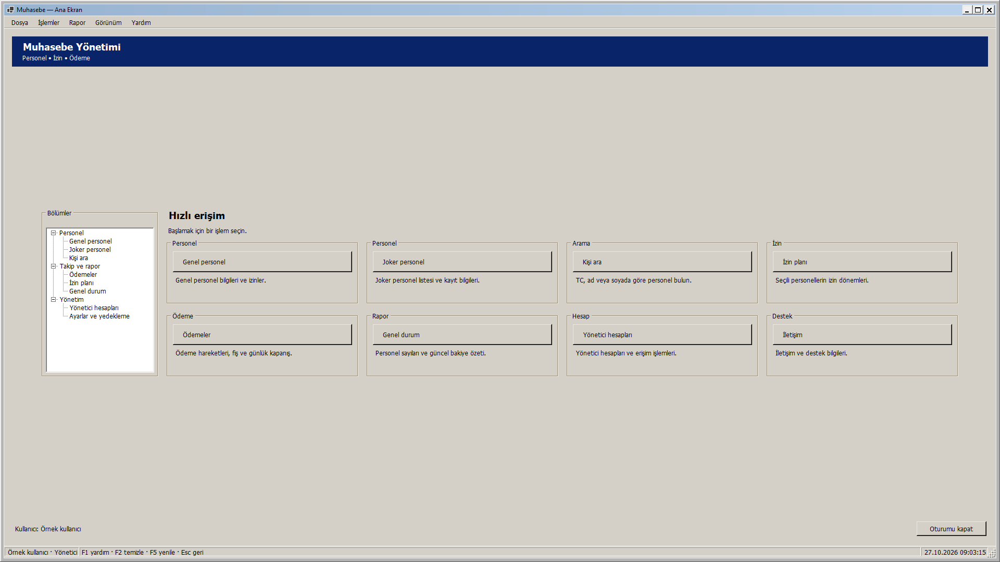
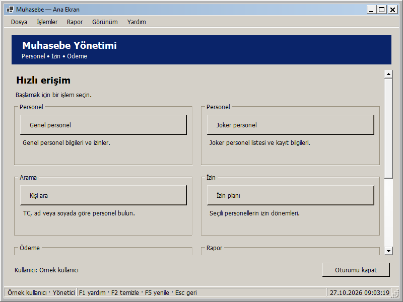
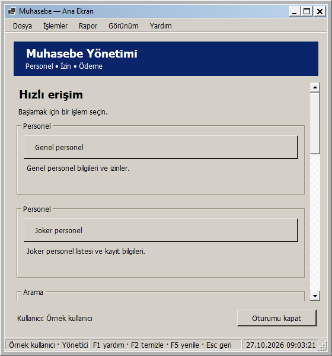

# Ana ekran: pencere boyutuna uyarlanan yerleşim

27 Ekim 2026 — Windows 2000 görünümü korunarak ana ekranın yerleşimi yeniden düzenlendi.

İşlem kartları kullanılabilir genişliğe göre **1, 2, 3 veya 4 sütuna** geçer. Kartların genişliği eşit paylaşılır; düğme yüksekliği ve aralıklar korunur. Kartlarda işlemi açıklayan kısa metinler vardır. Pencere daraltıldığında kartlar sırayla alt satırlara taşınır.

Sol bölüm ağacı yalnızca yeterli genişlik olduğunda gösterilir. Dar pencerede aynı sayfalara işlem kartlarından ve üst menüden ulaşılır; yönetici ayarları Dosya menüsünde kalır. Rol kısıtları, klavye kısayolları, mevcut işlem ve oturum akışları korunur. Yönetici olmayan kullanıcıda hesap kartı Parolamı değiştir işlemini gösterir.

İçerik yüksekliğe sığdığında çalışma alanı yatay ve dikey ortalanır. Kısa/dar pencerede yalnızca işlem alanı dikey kayar; başlık, menü ve çıkış düğmesi sabit kalır. Yatay kaydırma gerekmez. Pencerenin alt sınırı 560 × 480 mantıksal pikseldir; DPI ölçeklemesi uygulanır. Çok geniş ekranlarda içerik genişliği 1760 mantıksal piksel ile sınırlandırılır.

## Gerçek uygulama önizlemeleri

Geniş pencere, dört sütun ve sol menü:

Orta pencere, iki sütun:

Dar pencere, tek sütun ve dikey kaydırma:

Görseller yayımlanan yerel paketin DLL dosyasından, örnek oturum ve gerçek WinForms çizimiyle üretildi. Gerçek kullanıcı hesabıyla giriş yapılmadı.

## Doğrulama ve deneme

- **290 veritabanısız test başarılı; 0 başarısız, 0 atlanan.** Release derlemesi 0 uyarı / 0 hata. Kanıt: `artifacts/analysis/master-20261027-090008-715/master.trx`.
- Yeni üç rol testi, 47 genişliği iki yönde deneyerek toplam 282 boyutlandırma durumu kontrol eder. Sütun değişimleri, kartların çakışmaması, açıklamaların kesilmemesi, yatay taşma olmaması, son karta kaydırarak erişim ve büyütmede kaydırmanın temizlenmesi doğrulanır.
- Yayımlanan DLL ile üç rolde yedi boyut (560 × 600, 800 × 480, 800 × 600, 1040 × 720, 1366 × 768, 1920 × 1080, 1940 × 1080) olmak üzere **21 görsel yerleşim kontrolü**. Kanıt: `artifacts/analysis/dashboard-adaptive/layout-checks.json` ve PNG dosyaları. Ölçüler formun çerçevesini de içerir. 2560 × 1080 isteği Windows tarafından mevcut ekranın izleme sınırı olan 1940 × 1080 ölçüsüne sınırlandırıldı; bu son durum 1940 genişlikte doğrulandı, 2560 fiziksel ekran testi yapılmadı.
- Test ortamı 96 DPI'dır. Mantıksal ölçüler DPI ile ölçeklenir; farklı fiziksel DPI ortamı bu adımda ayrıca denenmedi.

Denemek için Muhasebe - Güncel kısayolunu açıp giriş yapın; pencereyi sağ kenarından daraltın/genişletin. Kartların sütun değiştirmesini, sol menünün geniş alanda görünmesini, dar alanda aşağı kaydırarak İletişim kartına ulaşmayı ve tekrar büyütünce kaydırmanın kalkmasını gözleyin.

Yerel paket: `artifacts/releases/dashboard-adaptive/`. Önceki güvenlik, izin, ödeme ve yedek aynalama düzeltmelerini de içerir. Yeni şema yoktur. Bu ekranın yerel geliştirme adımında GitHub'a push veya Release yapılmadı; toplu kaynak gönderimi için [responsive arayüzler](RESPONSIVE_ARAYUZLER.md) belgesine bakın.

## Önceki deneme

Aynı gün hazırlanan `dashboard-responsive` paketi yalnızca üç işlem grubunu ortalayıp genişliklerini eşitlemişti. Kullanıcının geri bildirimi üzerine yerini yukarıdaki sütun değiştiren düzene bıraktı. Önceki 287 test ve 12 rol/boyut kontrolünün kanıtları `artifacts/analysis/dashboard-responsive/` ve `artifacts/analysis/master-20261027-083049-321/` klasörlerinde korunur. Masaüstü kısayolunun o pakete geçirilmesi ve başarılı giriş hazırlığına ait kayıtlar da önceki klasördedir.

27 Ekim 2026 yerel dağıtım: Muhasebe - Güncel kısayolunun önceki bağlantısı yedeklendi; hedef dashboard-adaptive paketine geçirildi. Mevcut appsettings.json birebir korundu. Computer Use ile güncel paket açıldı; giriş ekranındaki hazır bildirimi ve process=5560 state=ready kaydı doğrulandı. Kullanıcının giriş yapması için uygulama açık bırakıldı. Kanıt: artifacts/analysis/dashboard-adaptive/deployment.json ve verification.json.
