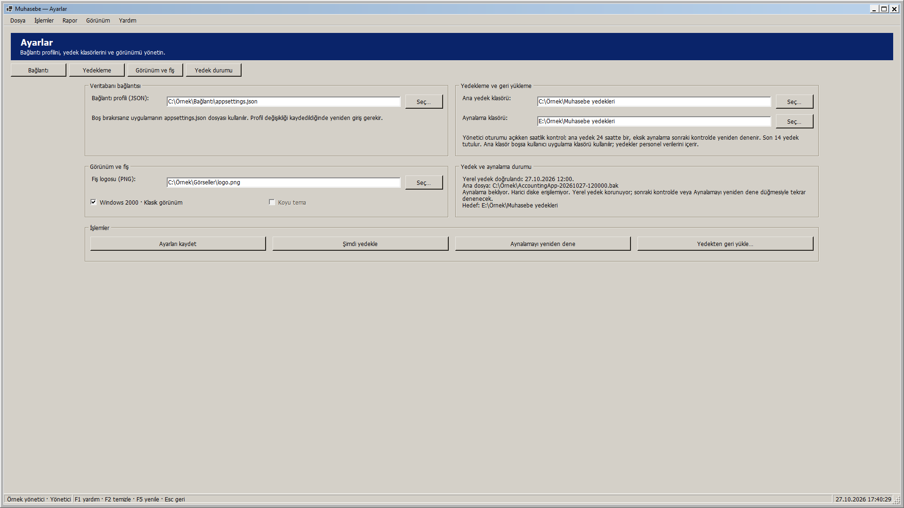
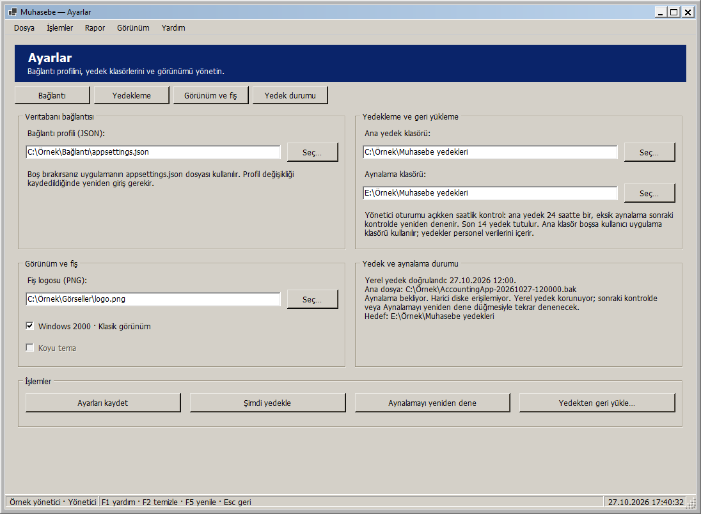
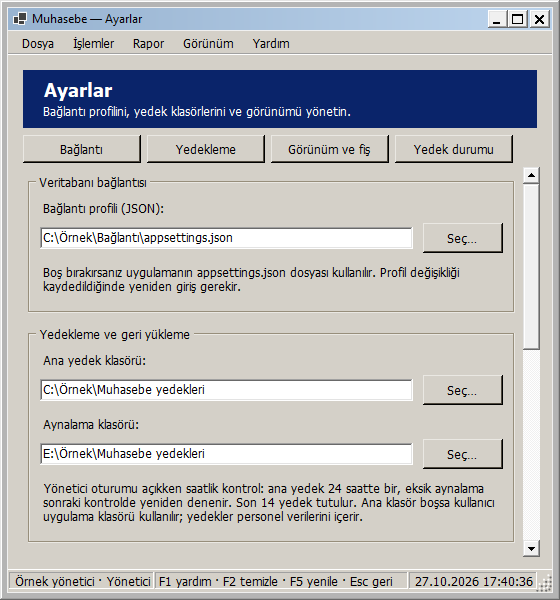
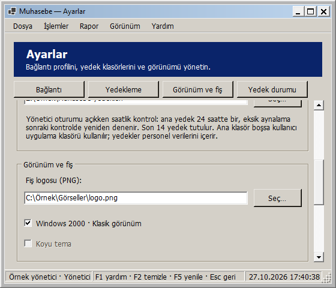
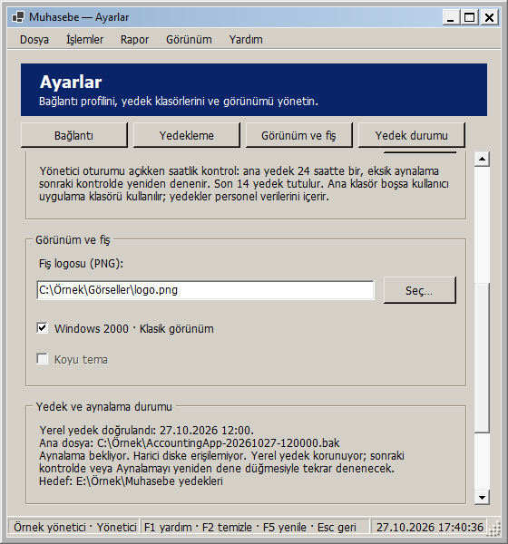
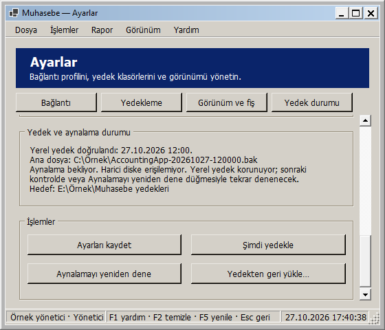

# Ayarlar: pencere boyutuna uyarlanan yerleşim

27 Ekim 2026 — Windows 2000 görünümü korunarak Ayarlar ekranı uyarlanabilir hale getirildi.

- Veritabanı bağlantısı, yedekleme, görünüm/fiş ve yedek durumu geniş pencerede iki sütuna, dar pencerede tek sütuna geçer. Aynı satırdaki bölümler hizalıdır.
- Bölüm genişliğine göre alan açıklamaları dosya yolunun soluna veya üstüne yerleşir. Dosya/klasör seçme düğmeleri sabit yükseklikte kalır. Uzun yollar alanda yatay gezinilerek okunabilir ve düzenlenebilir.
- Tema seçenekleri geniş bölümde yan yana, dar bölümde alt alta yerleşir. Klasik görünüm seçiliyken Koyu tema seçeneğinin devre dışı kalması korunur.
- İşlem düğmeleri geniş alanda dört, dar alanda iki sütundur. Kaydetme, yedekleme, aynalamayı yeniden deneme ve geri yükleme aynı düğme ve işleyicilerdir.
- Uzun yedek/aynalama durumu satır kırarak alanını büyütür. Metin değişiminde bölümün dış ölçüsü aynı kalsa bile metin alanı yeniden ölçülür. Durum kısalınca gereksiz kaydırma kalkar.
- Kısa pencerede içerik dikey kayar. Sabit üst düğmeler bağlantı, yedekleme, görünüm ve durum bölümlerine erişir; Tab ile alanlara geçerken içerik kaydırılır.
- En küçük pencere 560 × 480 mantıksal pikseldir. Çok geniş ekranda içerik 1560 mantıksal piksel ile sınırlanıp ortalanır. Ölçüler DPI ile ölçeklenir.

Yeniden boyutlandırmada girilmiş fakat kaydedilmemiş profil, ana yedek/aynalama ve logo yolları; tema seçimleri, durum metni ve etkin/pasif kontroller korunur. Kontroller yeniden oluşturulmaz. Yerleşim değişikliği kaydetme, dosya iletişim kutusu, durum sorgusu, yedekleme, aynalama veya geri yükleme çalıştırmaz. Profil değişiminde doğrulama/yeniden giriş ve mevcut yönetici erişim kısıtı aynı iş akışında kalır; bu adımda SettingsForm.cs işleyicileri değiştirilmedi.

## Önizlemeler

Tam ekran:

Normal pencere:

Dar pencere:

Dar pencerede görünüm, durum ve işlemler:

Görseller yayımlanan yerel DLL ile gerçek WinForms çiziminden üretildi. Klasörler, dosyalar ve yedekleme durumları örnektir; gerçek tercih veya yedek değiştirilmedi.

## Doğrulama

**337 veritabanısız test başarılı; 0 başarısız, 0 atlanan.** Release derlemesi ve Windows paketi 0 uyarı / 0 hata. Kanıt: `artifacts/analysis/master-20261027-173954-457/master.trx`.

Yeni dokuz yerleşim testi, yönetici oturumunda üç tema ve üç durum metni (boş, kısa, uzun) ile 26 genişliği iki yönde, toplam **468 boyutlandırma durumu** denetler. Panellerin çakışmaması, düğme/seçenek yazılarının sığması, değişmeyen kontrol kimlikleri, kaydedilmemiş yollar ve tema değerleri, durum metni ve etkin/pasif kontrollerin korunması doğrulanır. Minimum pencerede bölüm/alan/işlemlere erişim, durum metninin büyüyüp küçülmesi ve komşu bölüm nedeniyle boyutu değişmeyen kartta metnin yeniden ölçülmesi de kontrol edilir. İki ek test, personel sorumlusu ve görüntüleyicinin Ayarlar sayfasını açamadığını doğrular.

Yayımlanan DLL ile yönetici oturumunda üç tema × yedi pencere boyutu (1920 × 1080, 1366 × 900, 1096 × 804, 1000 × 740, 800 × 600, 560 × 600, 560 × 480), toplam **21 görsel yerleşim kontrolü** başarılı. Boyutlar çerçeve dahildir. Kanıt: `artifacts/analysis/settings-adaptive/layout-checks.json` ve aynı klasördeki PNG'ler. Yayımlanan paket, RID derlemesi ve görsel yardımcı aynı DLL özetine sahiptir.

Denemelerde gerçek ayar kaydetme, dosya seçimi, yedekleme/aynalama/geri yükleme ve durum sorgusu yapılmadı. Kontroller 96 DPI ortamındadır; farklı fiziksel DPI/monitör ayrıca denenmedi. Yeni SQL betiği yok; Bu ekranın yerel geliştirme adımında GitHub'a push veya Release yapılmadı; toplu kaynak gönderimi için [responsive arayüzler](RESPONSIVE_ARAYUZLER.md) belgesine bakın.

## Kendiniz deneyin

1. Muhasebe - Güncel kısayolundan yönetici olarak giriş yapıp Ayarlar ve yedekleme ekranını açın.
2. Pencereyi büyütün, daraltın ve kısaltın; bölümler, alanlar, seçenekler ve işlem düğmeleri yeniden yerleşir.
3. Bir alana kaydetmeden örnek yol girip tema seçeneklerini değiştirin; pencereyi yeniden boyutlandırınca değerler korunur.
4. Dar pencerede üst bölüm düğmeleri, dikey kaydırma ve Tab ile alttaki işlemlere erişimi deneyin.
5. Yerleşimi denemek için Kaydet, Şimdi yedekle, Aynalamayı yeniden dene veya Geri yükle düğmelerine basmanız gerekmez. Deneme yollarını kaydetmeden ana ekrana dönün.

Yerel paket: `artifacts/releases/settings-adaptive/`. Önceki uyarlanabilir ekranları ve güvenlik/izin/ödeme/yedek düzeltmelerini de içerir. Dağıtım ve açılış doğrulaması: `artifacts/analysis/settings-adaptive/deployment.json` ve `verification.json`.
