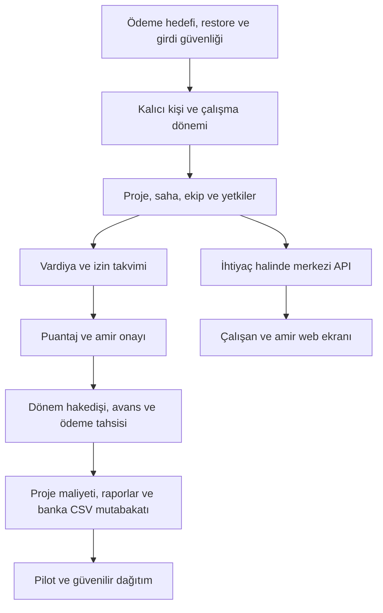

# Vardiya ve proje ekipleri için geliştirme yol haritası

6 Kasım 2026 güncellemesi: dağıtım kaynak akışı 1.3.32-dev / şema 137 / API 1.32 olarak hazırlandı. Kalan **2 ana iş paketi** doğrulama ve pilot/teslimdir. Denemeler, imza ve GitHub CI/Release yapılmadı; 7 Kasım 2026 yerel kurulumu doğrulanmış yedek sonrası 1.3.32-dev / değişmeyen 137 / API 1.32 olarak tamamlandı; denemeler atlandı. [Dağıtım kapsamı](DAGITIM_SONLANDIRMA_VE_COK_BILGISAYAR.md). Aşağıdaki notlar tarihseldir.

6 Kasım 2026 güncellemesi: [yedek/destek güvenliği](YEDEK_VE_DESTEK_GUVENLIGI.md) temel kaynak dilimi 1.3.31-dev / şema 137 / API 1.31 olarak eklendi. Kalan **3 ana iş paketi**: kurulum/dağıtım; performans/erişilebilirlik ve güvenlik doğrulaması; pilot/gerçek kurtarma/teslim. Denemeler atlandı; güvenlik kabulü ve kurtarma provası tamamlanmadı. Canlı istemci/API/kısayol, doğrulanmış yedek sonrası 1.3.31-dev / değişmeyen 137 / API 1.31 olarak güncellendi; denemeler ve gerçek kurtarma provası yapılmadı. Aşağıdaki notlar tarihseldir.

6 Kasım 2026 güncellemesi: Aşama 6–7'nin [rapor merkezi genişlemesi](RAPOR_MERKEZI_GENISLEMESI.md) temel kaynak dilimi 1.3.30-dev / hazırlanmış 137 / API 1.30 olarak eklendi. Kalan **4 ana iş paketi**: yedek/destek güvenliği, dağıtım sonlandırması, performans/erişilebilirlik doğrulaması, pilot/teslim. Denemeler atlandı; bu doğrulamalar açık iş olarak sürer. Doğrulanmış yedek sonrası canlı kurulum 1.3.30-dev / 137 / API 1.30'a geçirildi; kurulum kalan ana paket sayısını azaltmadı. Yeni kapsamın eforu ayrıca değerlendirilir. Aşağıdaki maddeler tarihsel plan ve ilerleme kayıtlarıdır.

28 Ekim 2026 · Başlangıç sürümü v1.2.0 · Hedef kullanıcı tercihi: vardiya ve proje bazlı çalışan ekipler.

Dayanaklar: [kod ve risk analizi](PROJE_DURUM_ANALIZI_2026_10_28.md), [GitHub karşılaştırması ve saha senaryoları](GITHUB_VE_SAHA_ANALIZI_2026_10_28.md). Aşağıdaki sürüm adları öneridir; henüz oluşturulmuş Release veya uygulama taahhüdü değildir.

Uygulama durumu: Aşama 1'in F01 ödeme seçim koruması yerel kaynakta tamamlandı; **646 test başarılı**. [Değişiklik ve deneme adımları](ODEME_SECIM_SURUM_KORUMASI.md). İzleyen öncelik F02 restore hata güvenliğidir; aşamanın geri kalanı henüz uygulanmadı.

## Ürün hedefi ve ilk kapsam

29 Ekim 2026: izin tarihleri değişiklik geçmişi kaynakta uygulandı; [107 yükseltmesi ve sınırlar](IZIN_DEGISIKLIK_GECMISI.md). İzin takvimi, hak ediş ve onay aşamaları bu adımın dışında kalır.

29 Ekim 2026: F05 kalıcı kimlik ve arşivleme kaynakta uygulandı; [kapsam ve 106 yükseltmesi](PERSONEL_KIMLIGI_VE_ARSIV.md). Ayrı işe giriş/çıkış dönemleri ve tam izin/alan değişiklik geçmişi sonraki işlerdir.

29 Ekim 2026, yedek kapsamı: F04 yerel kaynakta uygulandı; [kimlik, kapsam, geçiş sınırları](YEDEK_KIMLIGI_VE_KAPSAM.md). Çok süreçli kalıcı bakım kapısı ve süreç kesintisi kurtarma kapsamı henüz tamamlanmadı.

29 Ekim 2026, sonraki adım: F03 veri doğrulaması kaynakta uygulandı; [kapsam ve testlerin atlandığına ilişkin not](PERSONEL_VERI_DOGRULAMA.md). Aşama 1'in yedek kimliği/kapsam ayrımı ve daha geniş bakım kapısı işleri devam eder.

29 Ekim 2026: F02'nin şema hatası sonrası eski oturum canlanması yerel kaynakta düzeltildi. [Kapsam ve kalan bakım/kesinti işleri](GERI_YUKLEME_OTURUM_KORUMASI.md). İzleyen uygulama önceliği F03 veri doğrulamadır.

Kullanıcı tek akışta şu soruları yanıtlayabilmeli: **Kim, hangi proje/sahada, ne zaman çalışacak? Gerçekte ne kadar çalıştı? Kim onayladı? Bu çalışma ne kadar hakediş ve proje maliyeti üretti? Ne kadarı ödendi?**

İlk hedef, mevcut Windows uygulamasında iki proje üzerinden haftalık plan → onaylı puantaj → dönem hakedişi → kontrollü ödeme akışını tamamlamaktır. Genel/Joker etiketleri geçişte korunur. Mevcut PARA değeri, yeni modele doğrulanmış açılış bakiyesi olarak alınır; geçmiş maaş veya çalışma süresi uydurulmaz.

İlk sürümde kapsam dışı: resmi bordro/vergi/SGK hesabı, otomatik banka transferi, POS/depo/lot, tam genel muhasebe, sürekli konum/biyometri takibi, çok cihazlı çevrimdışı senkronizasyon. Sonraki ihtiyaç kararı bu sınırları değiştirebilir. Ücret ve izin kuralları işletmenin doğruladığı, tarihli parametreler olacaktır; hukuki kurallar bu analizden türetilmez.

## Bağımlılık sırası

## Aşama 0 — İş kuralları ve pilot veri sözlüğü

**Çıktı:** 2–3 kişi-günlük analiz, örnek hafta ve kullanıcı tarafından gözden geçirilebilir kurallar tablosu. Bu süre yalnızca kaba planlama varsayımıdır.

- Personel türleri, yeniden işe giriş, proje/saha/ekip ayrımı; bir kişinin gün içinde proje değiştirmesi.
- Saatlik/günlük/aylık ücretlerden hangilerinin ilk sürümde kullanılacağı. İlk teknik prototip saatlik onaylı süreyle sınırlanabilir; diğer türler açıkça kararlaştırılmadan dönüştürülmez.
- Mola, eksik kayıt, fazla mesai, yarım gün izin, gece vardiyasının iş günü ve proje maliyet dağıtımı.
- Kim planlar, kim onaylar, kim ücreti görür, kim ödeme kaydeder? Küçük işletmede birleşen roller varsa bu açık bir ayar olmalı.
- Pilot için aktif çalışan, aylık kayıt, eşzamanlı kullanıcı/cihaz ve proje sayısı; yerel mi merkezi mi kullanılacağı.
- Örnek günler: normal, gece, izin, eksik çıkış, iki projede çalışma ve avans. Başlangıçta sentetik veri.

**Bitiş ölçütü:** örnek haftanın planlanan/gerçekleşen saatleri, ücretlendirilen süreleri ve beklenen tutarları bir tabloyla açıklanabiliyor. Bakiye/hakediş/ödeme terimleri ortak anlam taşıyor.

## Aşama 1 — v1.2.1 önerisi: mevcut riskleri kapatma

**Tahmin:** 5–8 kişi-gün. Öncelik F01, F02 ve F03; ardından F04 için kapsam ayrımı.

| İş | Uygulama | Kabul ölçütü |
|---|---|---|
| Ödeme hedefi | Seçili TC/grup + özgün sürümün onaydan önce alınması; hazırlama/gönderim kontrolü; bekleyen istek biçiminin sürümlenmesi | Genel/Joker eski seçim yeni kaydı etkilemez; kayıp yanıt aynı RequestId ile en fazla bir kayıt üretir |
| Restore hata güvenliği | Hedef/yedek kimliği, uyumluluk ön kontrolü, süreçler arasında bakım kapısı, oturum nesli yenileme ve kurtarma durumu | Şema/audit/kesinti hatasında eski oturum geçersizdir; bakım tamamlanmadan işleme dönülmez |
| IBAN/normalize model | Doğrulanan nesnenin kaydı; ülke kapsamı + kontrol basamağı; mevcut hatalı veri raporu | Biçimsiz IBAN reddedilir, geçerli örnekler kabul edilir; eski kayıt sessizce değiştirilmez |
| Regresyon | Bu analizdeki sentetik kontrollerin kalıcı testlere dönüştürülmesi | Yeni testler düzeltme öncesi sorunu gösterir, sonra geçer; mevcut 610 test bozulmaz |

**Veri etkisi:** mevcut migration dosyaları değiştirilmez. Gerekirse 105'ten sonra yeni betik eklenir. Ödeme günlüğü uyumsuzsa silinmez; güvenli sonuç kontrolü/dönüşüm yapılır. Yedek ve geri dönüş prosedürü sürümle birlikte belgelenir.

## Aşama 2 — v1.3 önerisi: personel kartı ve proje temeli

31 Ekim 2026 kurulum güncellemesi: [119 / 1.3.8-dev](1_3_8_DEV_KURULUMU.md) kullanıcı onayıyla kuruldu. Yedek doğrulandı, eski içerikler korundu; proje ödeme bitleri kapalı ve talep tablosu boş başladı. İşlev denemeleri atlandı. Aşağıdaki ilk kaynak teslimi notları tarihsel durumdur.

31 Ekim 2026: [proje ödeme hazırlama ve onay ayrımı](PROJE_ODEME_HAZIRLAMA_VE_ONAY.md), kaynak 1.3.8-dev / hazırlanmış 119 / API 1.8 olarak eklendi. İki ayrı aktör ve canlı proje hakları; talep, karar ve tekrar güvenliğiyle bakiye/avans kaydı hazır. 119 uygulanmadı; kurulu 1.3.7-dev/118 korundu, denemeler atlandı. Puantaj/amir onayı ve vardiya-takvim işleri sonraki aşamalarda açık kalır; uçtan uca onaylı çalışma → hakediş akışı tamamlandı sayılmaz.

31 Ekim 2026 kurulum güncellemesi: [118 / 1.3.7-dev](1_3_7_DEV_KURULUMU.md) kullanıcı onayıyla kuruldu. Yedek doğrulandı, eski içerikler korundu; yeni görüntüleme bitleri kapalı başladı, yönetici tam erişimini sürdürür. İşlev denemeleri atlandı. Aşağıdaki ilk kaynak teslimi notları tarihsel durumdur.

31 Ekim 2026: [ücret ve IBAN görüntüleme ayrımı](UCRET_VE_IBAN_GORUNTULEME_YETKILERI.md), kaynak 1.3.7-dev / hazırlanmış 118 / API 1.7 olarak eklendi. Görüntüleme, edit, ödeme ve export ayrımı servis/API sınırında uygulanır. 118 uygulanmadı, çalışan 1.3.6-dev/117 korundu, denemeler atlandı. Aşama 2 tümüyle tamamlanmadı: proje bazlı ödeme/puantaj onayları ve sonraki vardiya modülü açık kalır.

31 Ekim 2026 kurulum güncellemesi: [117 / 1.3.6-dev](1_3_6_DEV_KURULUMU.md) kullanıcı onayıyla kuruldu. Yedek doğrulandı, eski içerikler korundu; hiçbir kişi başka gruba taşınmadı. İşlev denemeleri atlandı. Aşağıdaki ilk kaynak teslimi notları tarihsel durumdur.

31 Ekim 2026: [tarihli personel grubu geçişi](TARIHLI_PERSONEL_GRUBU_GECISI.md), 1.3.6-dev / hazırlanmış 117 / API 1.6 olarak eklendi. Genel/Joker dönem ayrımı, geçmiş, sürüm ve tekrar koruması hazır; bakiyeli veya geleceğe planlı geçiş kapsam dışı. 117 uygulanmadı; kurulu 1.3.5-dev/116 kullanıcı tarafından doğrulandı ve korundu. Denemeler atlandı. Aşama 2 tümüyle tamamlanmadı: daha ince alan görüntüleme yetkileri ve proje ödeme/puantaj onayı açık kalır.

31 Ekim 2026 kurulum güncellemesi: [116 / 1.3.5-dev](1_3_5_DEV_KURULUMU.md) kullanıcı onayıyla kuruldu. Yedek doğrulandı, eski veri/audit içerikleri korundu; işlev denemeleri atlandı. Aşağıdaki kaynak teslim notları tarihsel durumdur.

31 Ekim 2026: kullanıcı 1.3.4-dev bütünleşik kart kurulumunu doğruladı. İzleyen hassas audit dilimi [veri minimizasyonu](ISLEM_GECMISI_VERI_MINIMIZASYONU.md), kaynak 1.3.5-dev / hazırlanmış 116 / API 1.5 olarak eklendi. Yeni gövdeler maskeli saklanır, eski gövdeler değiştirilmeden maskeli okunur; değişen alan adları korunur. 116 uygulanmadı, kurulu 1.3.4-dev/115 korundu, denemeler atlandı. Tarihli grup geçişi, tüm ekranlarda alan bazlı görüntüleme yetkileri ve proje ödeme/puantaj onayı açık kalır.

31 Ekim 2026 izleyen kaynak dilimi: [bütünleşik personel kartı](BUTUNLESIK_PERSONEL_KARTI.md), 1.3.4-dev / API 1.4 olarak eklendi. Mevcut şema 115 kullanılır; yeni migration yok. Kurulu 1.3.3-dev değiştirilmedi, denemeler atlandı. Bütünleşik kart dilimi hazır; tarihli grup geçişi, daha ince hassas alan politikası ve proje bazlı ödeme/puantaj onayı açık kalır.

31 Ekim 2026 kurulum güncellemesi: [115 ve 1.3.3-dev istemci/API kurulumu](1_3_3_DEV_KURULUMU.md) kullanıcı onayıyla tamamlandı; yedek doğrulandı, eski veri içerikleri korundu. Proje üyelikleri/sorumlulukları boş başlar; işlev denemeleri atlandı. Aşağıdaki kaynak teslimi notları tarihsel kapsamdır.

31 Ekim 2026 izleyen kaynak dilimi: [proje sorumlusu ve proje bazlı erişim](PROJE_SORUMLUSU_VE_YETKILER.md), yeni kısıtlı ProjectUser rolüyle eklendi. Ekip/atama yönetimi, maliyet okuma ve CSV rapor izinleri ayrı; genel merkez rolleri korunur. Kaynak 1.3.3-dev / şema 115 / API 1.3; 115 uygulanmadı, çalışan 1.3.2-dev/114 değiştirilmedi. Denemeler atlandı. Proje bazlı ödeme/puantaj onayı, daha ince hassas alan politikaları, bütünleşik kart ve tarihli grup geçişi açık kalır; tüm Aşama 2 tamamlandı olarak işaretlenmedi.

31 Ekim 2026 kurulum güncellemesi: [114 ve 1.3.2-dev istemci/API kurulumu](1_3_2_DEV_KURULUMU.md) kullanıcı onayıyla tamamlandı; yedek doğrulandı, veri içerikleri korundu. İşlev denemeleri atlandı. Aşağıdaki kaynak teslimi notları tarihsel kapsamdır.

31 Ekim 2026 izleyen kaynak dilimi: [ayrı çalışma dönemleri, işe giriş/ayrılış ve yeniden işe giriş](CALISMA_DONEMLERI.md) eklendi. Kaynak 1.3.2-dev, şema 114 ve API 1.2; 114 henüz uygulanmadı, kurulu 1.3.1-dev/113 korundu. Kullanıcı 1.3.1-dev'in düzgün çalıştığını bildirdi. Denemeler atlandı. Aşağıdaki 113 kaynak teslimi notu tarihsel kapsamdır. Proje kapsamlı erişim, sorumlu hesap, tarihli grup geçişi ve bütünleşik kart açık kalır; Aşama 2 tamamlandı olarak işaretlenmedi.

31 Ekim 2026 kaynak dilimi: [proje/saha, ekip ve tarihli asıl atamalar](PROJE_EKIP_VE_TARIHLI_ATAMALAR.md) eklendi. Şema 113 hazırlanmıştır, uygulanmadı; denemeler atlandı. Ayrı Employment dönemleri, sorumlu hesap/proje kapsamlı izinler ve bütünleşik personel kartı bu aşamada açık kalır. Bu not Aşama 2'nin tamamlandığını belirtmez.

**Tahmin:** 8–12 kişi-gün. Yeni modüllerin kimlik temeli burada kurulur.

- Person, Employment ve tarihli personel türü/grubu; işe giriş/ayrılış ve arşiv. Silme yerine kontrollü arşiv.
- Proje kodu/adı, saha, ekip, sorumlu kullanıcı, proje aktiflik aralığı. Önce müşteri cari yerine isteğe bağlı müşteri etiketi yeterlidir.
- Personelin tarihli ekip/proje ataması; ekipler arası değişiklik geçmişi.
- Personel kartı: aktif dönem, atamalar, izin geçmişi, hakediş/ödeme hareketleri ve işlem geçmişi sekmeleri.
- Proje kapsamlı izinler: planlama, puantaj girişi/onayı, maliyet görüntüleme, ödeme hazırlama/onaylama, hassas alan görüntüleme, dışa aktarma.
- Audit'e hedef kayıt, korelasyon ve gerekçe; hassas alanları ham metinle günlüğe dökmeme.

**Göç:** mevcut Calisan/Joker satırlarına kalıcı kimlik atanır. TC dış kimlik olur; teknik anahtar olmaz. Eski defter Closure sınırlarıyla uzlaştırılır; tarihsel personel bilgisi yoksa “eski dönem / bilinmeyen ayrıntı” tutulur. İzin satırları fiziksel silinmez. Genel/Joker ekranları aynı yeni servisin filtreli görünümü olarak bir süre korunabilir.

**Bitiş ölçütü:** ayrılan kişi arşivde, yeniden işe giren kişi yeni EmploymentId ile görünür; eski ödeme/izin geçmişi yeni döneme karışmaz. Eski ve yeni defter toplamları kişi/grup/dönem düzeyinde eşleşir. Proje A amiri Proje B verisini servis veya raporla alamaz.

## Aşama 3 — v1.4 önerisi: vardiya ve izin takvimi

31 Ekim 2026 kurulum güncellemesi: doğrulanmış yedek sonrası 120 uygulandı; 1.3.9-dev istemci/API ve masaüstü kısayolu güncellendi. Mevcut veriler/ayarlar korundu, denemeler atlandı. [Kurulum kaydı](1_3_9_DEV_KURULUMU.md). Aşağıdaki kaynak teslimi notu kurulum öncesini anlatır.

31 Ekim 2026: [vardiya ve izin takvimi](VARDIYA_VE_IZIN_TAKVIMI.md), kaynak 1.3.9-dev / hazırlanmış 120 / API 1.9 olarak eklendi. Haftalık görünüm, şablon/kapasite/gece vardiyası, taslak/yayın/iptal, önizlemeli atomik kopyalama, talep/karar ve eski izin çakışma koruması hazır. 120 uygulanmadı; kullanıcı tarafından doğrulanan 1.3.8-dev/119 korundu. Denemeler atlandı. Mevzuat/izin hakkı ve tatil politikası, çalışan self servis eşlemesi ve sonraki puantaj işleri açık kalır; uçtan uca işçilik/ücret akışı tamamlandı sayılmaz.

**Tahmin:** 7–12 kişi-gün.

- Haftalık ekip/proje görünümü, vardiya şablonu ve somut vardiya örneği. Başlangıç/bitiş, mola politikası, saha, gereken kişi sayısı ve sorumlu.
- Önce basit form/tabloyla planlama; sürükle-bırak daha sonra. Toplu kopyalama önizleme ve onayla çalışır.
- Taslak → yayınlandı → iptal durumları; yayınlanan atamanın değişiklik gerekçesi ve sürüm kontrolü.
- Aynı personelin çakışan atamalarını, proje atama aralığı dışını ve onaylı izinle çakışmayı kontrol et. Ekip kapasitesini ve eksik kişiyi göster.
- Ayrı LeaveRequest/izin dönemi kimliği; talep, onay, ret, iptal ve ekip takvimi. İzin hesabının kaynağında takvim ve politika sürümü tutulur.

**Bitiş ölçütü:** gece 22:00–06:00 tek vardiya; ertesi günkü atamayla karışmaz. Bitiş anı başka atamanın başlangıcına eşitse çakışma sayılmaz. Eşzamanlı iki plan aynı kişiyi çakışan görevlere yerleştiremez. Genel izin kaydetme ve İzin Planlama yeni geçmiş modelini güvenli kullanır.

## Aşama 4 — v1.5 önerisi: puantaj, istisnalar ve onay

2 Kasım 2026 kaynak dilimi: [çok kişili toplu manuel puantaj](TOPLU_MANUEL_PUANTAJ.md), 1.3.17-dev / mevcut 127 / API 1.17. Vardiyalı/vardiyasız yeni satırlar, ortak saat/gözden geçirme, tek önizleme ve atomik paket kaydı eklendi. Kaynak sürümleri, şifreli taslak ve tek makbuz/kalıcı vazgeçme korumaları sürer. Yeni şema yok; canlı 1.3.16-dev/127 ve kısayol korundu, denemeler atlandı. Aşama 4 saha kabulü ve çalışan self servis ayrı kalır; izleyen iş Aşama 5 tarihli ücret tarifesi ve dönem hakedişi temelidir.

2 Kasım 2026 kurulum güncellemesi: doğrulanmış yedek sonrası 127 uygulandı; 1.3.16-dev istemci/API ve Muhasebe - Güncel kısayolu güncellendi. Mevcut veriler/ayarlar korundu; vazgeçme makbuzları boş başladı. Denemeler atlandı. [Kurulum kaydı](1_3_16_DEV_KURULUMU.md). Aşağıdaki kaynak teslimi notları tarihsel kapsamdır.

2 Kasım 2026 kaynak dilimi: [kalıcı puantaj taslak kurtarma](KALICI_PUANTAJ_TASLAK_KURTARMA.md), 1.3.16-dev / hazırlanmış 127 / API 1.16. Yerel şifreli alan/önizleme taslakları ve belirsiz istek kurtarma; özgün sürüm, hesap/veritabanı/proje kapsamı ve kalıcı vazgeçme makbuzu eklendi. 127 uygulanmadı; canlı 1.3.15-dev/126 ve kısayol korundu, denemeler atlandı. İzleyen iş çok kişili toplu manuel giriş; çalışan self servis ayrıca açık kalır. Aşama 4 tamamlanmadı.

2 Kasım 2026 kurulum güncellemesi: doğrulanmış yedek sonrası 126 uygulandı; 1.3.15-dev istemci/API ve Muhasebe - Güncel kısayolu güncellendi. Mevcut veriler/ayarlar korundu; otomatik hesap/personel eşlemesi yapılmadı. Denemeler atlandı. [Kurulum kaydı](1_3_15_DEV_KURULUMU.md). Aşağıdaki kaynak teslimi notları tarihsel kapsamdır.

2 Kasım 2026 kaynak dilimi: [çalışan–hesap eşlemesi](CALISAN_HESAP_ESLEMESI.md), 1.3.15-dev / hazırlanmış 126 / API 1.15 olarak eklendi. Yönetici açık eşleme yapar; geçmiş kimlik kanıtı korunur, puantajda aynı kişi/kendi çalışma onayı reddedilir. Eşleme erişim hakkı vermez. 126 uygulanmadı; canlı 1.3.14-dev/125 ve kısayol korundu, denemeler atlandı. Sonraki işler kalıcı taslak kurtarma ve çok kişili toplu manuel giriş; çalışan self servis ayrıca açık kalır. Aşama 4 tamamlanmadı.

2 Kasım 2026 kurulum güncellemesi: doğrulanmış yedek sonrası 125 uygulandı; 1.3.14-dev istemci/API ve Muhasebe - Güncel kısayolu güncellendi. Mevcut veriler/ayarlar korundu, eski dağılımlar eski onay modeliyle kaldı; denemeler atlandı. [Kurulum kaydı](1_3_14_DEV_KURULUMU.md). Aşağıdaki kaynak teslimi notları tarihsel kapsamdır.

2 Kasım 2026 kaynak dilimi: [bağımsız proje parçası onayı](BAGIMSIZ_PROJE_PARCASI_ONAYI.md), 1.3.14-dev / hazırlanmış 125 / API 1.14 olarak eklendi. Proje amiri yalnız kendi parçasında karar verir; tur, ana durum ve proje süreleri tutarlı türetilir. Karar olayları değişmez; eski toplu kayıtlar yerel iade/yeniden gönderimle geçer. 125 uygulanmadı; kullanıcı tarafından doğrulanan 1.3.13-dev/124 ve kısayol korundu, denemeler atlandı. Çalışan–hesap eşlemesi, taslak kurtarma ve toplu manuel giriş açık kalır; Aşama 4 tamamlanmadı.

2 Kasım 2026 son kurulum güncellemesi: doğrulanmış yedek sonrası 124 uygulandı; 1.3.13-dev istemci/API ve Muhasebe - Güncel kısayolu güncellendi. Mevcut puantaj/ham olaylar dahil veriler ve ayarlar korundu; dağılım tabloları boş, mevcut atamalar asıl başladı. Denemeler atlandı. [Kurulum kaydı](1_3_13_DEV_KURULUMU.md). Aşağıdaki kaynak teslimi notları tarihsel kapsamdır.

2 Kasım 2026 kaynak dilimi: [gün içi proje/mola dağılımı](GUN_ICI_PROJE_VE_MOLA_DAGILIMI.md), 1.3.13-dev / hazırlanmış 124 / API 1.13 olarak eklendi. Ek proje ataması, tam kapsayan değişmez zaman parçaları, açık mola/ücret dakikası uzlaştırması, bütün projeler için atomik onay ve kapsamlı tek sayımlı süre özetleri hazır. 124 uygulanmadı; kullanıcı tarafından doğrulanan 1.3.12-dev/123 ve kısayol korundu, denemeler atlandı. Bağımsız parça onayı, hesap eşlemesi, taslak kurtarma ve toplu manuel giriş açık; Aşama 4 tamamlanmadı.

2 Kasım 2026 son kurulum güncellemesi: doğrulanmış yedek sonrası 123 uygulandı; 1.3.12-dev istemci/API ve Muhasebe - Güncel kısayolu güncellendi. Mevcut puantajlar dahil veriler/ayarlar korundu, ham olay/eşleme tabloları boş başladı. Denemeler atlandı. [Kurulum kaydı](1_3_12_DEV_KURULUMU.md). Aşağıdaki kaynak teslimi notları tarihsel kapsamdır.

2 Kasım 2026 kaynak dilimi: [ham olaylar ve kontrollü eşleme](HAM_OLAYLAR_VE_PUANTAJ_ESLEMESI.md), 1.3.12-dev / hazırlanmış 123 / API 1.12 olarak eklendi. Kaynak olayların değişmez/tekrarsız alımı, tek kişilik CSV, açık giriş/çıkış seçimi ve dakika politikası önizlemesi, eşleme/kaldırma/yoksayma, kaynak katılımcılarını da içeren görev ayrımı hazır. 123 uygulanmadı; kullanıcı tarafından doğrulanan 1.3.11-dev/122 ve kısayol korundu, denemeler atlandı. Sonraki dilim gün içi çok proje zaman parçaları ve mola dağıtımıdır; fiziksel cihaz entegrasyonu, hesap eşlemesi ve taslak kurtarma açık. Aşama 4 bütünüyle tamamlanmadı.

2 Kasım 2026 kurulum güncellemesi: doğrulanmış yedek sonrası düzeltilen 122 uygulandı; 1.3.11-dev istemci/API ve masaüstü kısayolu güncellendi. Mevcut puantajlar dahil veriler/ayarlar korundu, denemeler atlandı. [Kurulum kaydı](1_3_11_DEV_KURULUMU.md). Aşağıdaki kaynak teslimi notları tarihsel kapsamdır.

1 Kasım 2026 kaynak dilimi: [vardiyasız puantaj](VARDIYASIZ_PUANTAJ.md), 1.3.11-dev / hazırlanmış 122 / API 1.11 olarak eklendi. Tarihli proje/ekip atamasına bağlı gerçek çalışma, eski seçim/sürüm, tekrar ve farklı hesapla onay korumalarıyla kaydedilir; takvim/izin çakışma yolları vardiyasız kayıtları da kapsar. 122 uygulanmadı; kullanıcı tarafından doğrulanan 1.3.10-dev/121 ve kısayol korundu, denemeler atlandı. İzleyen dilim ham giriş/çıkış olayları ve kontrollü puantaj eşlemesidir. Çok proje/gün içi parçalar, mola dağıtımı, hesap eşlemesi ve taslak kurtarma açık; Aşama 4 tamamlanmadı.

31 Ekim 2026 kurulum güncellemesi: doğrulanmış yedek sonrası 121 uygulandı; 1.3.10-dev istemci/API ve Muhasebe - Güncel kısayolu güncellendi. Mevcut veriler/ayarlar korundu, denemeler atlandı. [Kurulum kaydı](1_3_10_DEV_KURULUMU.md). Aşağıdaki kaynak teslimi notu kurulum öncesini anlatır.

31 Ekim 2026 kaynak dilimi: [manuel/CSV puantaj ve amir onayı](PUANTAJ_VE_AMIR_ONAYI.md), 1.3.10-dev / hazırlanmış 121 / API 1.10 olarak eklendi. Kaynak vardiya/dönem kimlikleri, ham saat/mola/net ve ücret dakikası ayrımı, istisnalar, farklı hesapla onay/iade/yeniden açma, atomik ve tekrar korumalı aktarım hazır. 121 uygulanmadı; kullanıcı tarafından doğrulanan 1.3.9-dev/120 ve kısayol korundu, denemeler atlandı. Aşama 4 tamamlanmadı: vardiyasız/ham olay akışı, gün içi çok proje parçaları, mola dağıtımı, çalışan hesabı eşlemesi ve taslak kurtarma açık. Hakediş üretimi Aşama 5'te kalır.

**Tahmin:** 12–18 kişi-gün; ilk uçtan uca operasyon pilotu bu aşamada başlar.

- Manuel günlük/toplu puantaj ve kontrollü CSV içe alma; kaynak satır/hareket kimliğiyle tekrar koruması.
- Ham giriş/çıkış, mola, vardiyaya atama, gerçekleşen süre ve ücretlendirilecek süre ayrı alanlar.
- Eksik giriş/çıkış, çakışan kayıt, aşırı uzun süre ve izinle çelişki için istisna kuyruğu. Otomatik düzeltme yerine öneri + gerekçe.
- Gün içi proje dağıtımı: zaman aralıkları ve maliyet kırılımı. Aynı dakikanın iki projede sayılması engellenir; mola tekrarlanmaz.
- Taslak → gönderildi → onaylandı / iade edildi. Kendi kaydını onaylama kuralı; onaylanmış veriyi değiştirmek için yeniden açma ve gerekçe.
- Kaydedilmemiş değişiklik uyarısı, güvenli taslak, klavye ile toplu giriş ve satır yanında hata açıklaması.

**Bitiş ölçütü:** kaçırılan çıkış ertesi girişin türünü bozmaz. Yeniden içe alma çoğaltmaz. İki amirin eşzamanlı onayı tek sonuç üretir. İş günü/saat dilimi ortak ayardan gelir. Aylık ve gece vardiyası sınırlarında süreler tutar; onaysız satırlar hakedişe katılmaz.

## Aşama 5 — v1.6 önerisi: hakediş, avans ve kontrollü ödeme

6 Kasım 2026 güncel kaynak: [ek ücret/gider kuralları](EK_UCRET_VE_GIDER_KURALLARI.md), **1.3.29-dev / hazırlanmış 136 / API 1.29**. Tarihli/bağımsız onaylı kural sürümü ve açık beyan, günlük/aylık temel, saatlik kaynağa ek fazla mesai farkı, ek ödeme ve doğrudan proje gideri eklendi. Hazırlama/onay/tek aktarım/tam ters aktarım ayrıdır; kimlik, çalışma dönemi, rowversion, tahsis ve çift temel ücret korumaları kullanılır. Mevzuat ve hak birimi otomatik varsayılmaz. Canlı 1.3.28-dev/135 korundu; denemeler atlandı. Aşamanın temel kural dilimi kaynakta ele alındı; doğrulama/pilot, otomatik bordro veya geniş ücret politikaları tamamlanmış sayılmaz. Kalan **5 ana paket**, sıradaki **rapor merkezi genişlemesi**: [güncel liste](KALAN_IS_PAKETLERI_2026_11_06.md). Aşağıdaki notlar tarihsel dilimlerdir.

6 Kasım 2026 güncel kaynak: [ödeme ve avans tahsisi](ODEME_VE_AVANS_TAHSISI.md), **1.3.22-dev / hazırlanmış 132 / API 1.22**. Mevcut para çıkışı hakedişe bağlanır; kısmi tahsis, değişmez serbest bırakma, kaynak limitleri, iptal ve mali düzeltme korumaları eklendi. Canlı 1.3.21-dev/131 korundu; denemeler atlandı. Sonraki dilim proje bazlı hakediş/ödeme/avans/tahsis mutabakat raporudur. Aşama 5'in fazla mesai/gündelik/masraf türleri, geniş geçmiş araması ve pilot doğrulaması açık kaldığından aşamanın tamamı bitmiş sayılmaz. Aşağıdaki önceki notlar tarihsel kapsamdır.

6 Kasım 2026 güncel kaynak: [bağlı bağımsız onaylı mali düzeltme/ters hareket](BAGLI_MALI_DUZELTME_VE_TERS_HAREKET.md), **1.3.21-dev / hazırlanmış 131 / API 1.21**. Aktarılmış kişi satırı için eski/yeni tutar, bağlantılı zincir, bağımsız onay ve tek seferlik Allocation/bakiye aktarımı eklendi; maliyet ve proje kalan hakedişi farkı içerir. Canlı 1.3.20-dev/130 korundu; denemeler atlandı. Sonraki Aşama 5 işi ödeme/avans tahsisidir; Aşama 5 tamamlanmadı. Aşağıdaki önceki notlar tarihsel kapsamdır.

6 Kasım 2026: Kullanıcı 1.3.19-dev / 129 sürümünü doğruladı; bağımsız mali onay ve tek seferlik aktarım kurulu. Yeni kaynak dilimi [bağlı ek dönem hesabı](EK_DONEM_HAKEDISI.md), **1.3.20-dev / hazırlanmış 130 / API 1.20**: yalnız geç gelen, kullanılmamış onaylı kaynaklar asıl hesaba bağlı ayrı ek olarak hazırlanır; ayrı bağımsız onay/aktarım gerektirir. 130 uygulanmadı; canlı kurulum ve kısayol korunur, denemeler atlandı. Sonraki adım bağlantılı bağımsız onaylı mali ters hareket/düzeltme, ardından ödeme/avans tahsisidir. Aşama 5 tamamlanmadı. Aşağıdaki eski kaynak notları tarihseldir.

2 Kasım 2026 kaynak dilimi: [tarihli saatlik TL tarife ve dönem hesap temeli](TARIHLI_TARIFE_VE_DONEM_HAKEDISI.md), 1.3.18-dev / hazırlanmış 128 / API 1.18. Değişmez oran/kaynak snapshot'ları, açık satır yuvarlaması, tekil kaynak ve kaynak/onay kilidi eklendi. Bu yalnız hesap dökümüdür; mali onay/deftere-bakiyeye aktarım, bağlantılı düzeltme ve ödeme tahsisi sonraki işlerdir. 128 uygulanmadı; canlı 1.3.17-dev/127 ve kısayol korundu, denemeler atlandı. Aşama 5 tamamlanmadı.

2 Kasım 2026 kurulum güncellemesi: doğrulanmış yedek sonrası 1.3.17-dev istemci/API ve kısayol güncellendi; şema 127 ve güvenlik nesilleri korundu, denemeler atlandı. [Kurulum kaydı](1_3_17_DEV_KURULUMU.md).

**Tahmin:** 10–16 kişi-gün.

- Personel/çalışma dönemi için tarihli ücret tarifesi; onaylı puantajın kullandığı oran/politika sürümü sonuçta saklanır.
- Hakediş dönemi ve satırları: kaynak puantaj, miktar, birim, oran, tutar ve proje maliyet dağılımı.
- Fazla mesai, gündelik, masraf ve avans ilk aşamada açık türler/ayrı onaylarla; otomatik mevzuat katsayısı varsayılmaz.
- Ödeme yöntemi, tarih, açıklama/referans; PaymentAllocation ile hakediş/avans ilişkisi. Kaydetmek ve banka gerçekleşmesi ayrı durumlar.
- Dönem onayı ve kilidi; aynı dönem/kaynak için tekrar üretim yasağı. Sonradan düzeltme bağlantılı yeni hareketle yapılır.
- Finansal görev ayrımı: hazırlayan ve onaylayan. Mevcut idempotent ödeme çekirdeği korunur; yeni akış onun üzerine kontrollü bağlanır.

**Hesap sınırı:** bu modül onaylı işçilik hakedişidir; resmi bordro değildir. Kesinti/prim/vergi ve bordro aktarımı ayrı doğrulanmış kurallar/entegrasyon ister.

**Bitiş ölçütü:** örnek haftanın kaynak kayıtları ve onaylarıyla hesaplanan tutar elle hazırlanmış referansla eşleşir. Bir puantaj iki hakedişe yazılamaz. Geçmiş oran değişince onaylı dönem tutarı değişmez. Ödenen tutar mevcut bakiyeyi aşamaz; avans ve kısmi ödeme iki kez düşülmez. İptal gerekçesi/özgün hareket bağlantısı tutulur.

## Aşama 6 — v1.7 önerisi: proje maliyeti, rapor ve mutabakat

6 Kasım 2026 güncel kaynak dilimi: [kalıcı mali dönem kapanışı](KALICI_MALI_DONEM_KAPANISI.md), **1.3.28-dev / hazırlanmış 135 / API 1.28**. Tamamlanmış İstanbul kayıt günleri için tek proje zinciri, değişmez açılış/dönem/kümülatif snapshot, tekil kaynak sahiplenme, önceki kapanış/satıra bağlı sonraki mali düzeltme ve sabit CSV eklendi. Sonraki mali işlemler eski kapanışı değiştirmez; mevcut bağımsız onay ve ödeme kontrolleri korunur. Projesiz kayıtlar/global bakiye, çalışma dönemi kilidi ve yeniden açma bu dilimde yoktur. Canlı 1.3.27-dev/134 korunuyor; denemeler atlandı. Kalan **6 ana paket**, sıradaki **ek ücret/gider kuralları**: [güncel liste](KALAN_IS_PAKETLERI_2026_11_06.md). Aşağıdaki notlar önceki tarihsel dilimlerdir.

6 Kasım 2026 güncel kaynak dilimi: [banka CSV ve mevcut ödeme eşleştirme](BANKA_CSV_VE_ODEME_ESLESTIRME.md), **1.3.27-dev / hazırlanmış 134 / API 1.27**. Kaynak hesap/işlem kimliği, açık biçim ve sütun seçimi, önizleme/tekrar/çelişki denetimi, atomik aktarım, manuel dekont onayı ve tekil aktif ödeme bağlantısı eklendi. Yeni para hareketi üretilmez. Gerekçeli kaldırma geçmişi ve eşleşmiş ödeme iptal koruması korunur. Yalnız tam TRY tutarlı bir hareket ↔ bir mevcut ödeme; döviz/kısmi/toplu ve otomatik fark kapama kapsam dışı. Canlı 1.3.26-dev/133 ve kısayol korunuyor; denemeler atlandı. Kalan **7 ana paket**, sıradaki **kalıcı mali dönem kapanışı**: [güncel liste](KALAN_IS_PAKETLERI_2026_11_06.md). Aşağıdaki notlar önceki tarihsel dilimlerdir.

6 Kasım 2026 güncel kaynak: [proje bütçesi ve maliyet sapması](PROJE_BUTCESI_VE_MALIYET_SAPMASI.md), **1.3.26-dev / hazırlanmış 133 / API 1.26**. Revizyonlu işçilik/diğer gider bütçesi, gerçek maliyet/sapma/kullanım ve yetkili rapor eklendi. Canlı 1.3.25-dev/132 korundu, denemeler atlandı. Bu bütçe dilimi sonrasında açık kapsam [8 ana iş paketinde](KALAN_IS_PAKETLERI_2026_11_06.md) gruplandı; sonraki ana dilim banka CSV ve kullanıcı onaylı ödeme eşleştirmesidir. Aşama 6–7 ve Aşama 5'in açık genişlemeleri henüz tamamlanmadı.

6 Kasım 2026 güncel kaynak: [planlanan/gerçekleşen kişi-saat karşılaştırması](PLAN_GERCEKLESEN_PROJE_KISI_SAAT.md), **1.3.25-dev / mevcut 132 / API 1.25**. Kadro ihtiyacı/atanmış plan ve proje onaylı net süre; bekleyen/taslak, çok proje/vardiyasız ve tam onaylı ücret süreleri ayrı raporlanır. Filtreli/sayfalı ayrıntı ve yetkili CSV eklendi. Canlı 1.3.24-dev/132 korundu; denemeler atlandı. Sonraki dilim proje bütçesi ve gerçekleşen maliyet sapmasıdır. Banka eşleştirmesi, kalıcı mali dönem kapanışı ve pilot doğrulaması açık; Aşama 6 tamamlanmadı.

6 Kasım 2026 güncel kaynak: [mali filtreler ve sayfalama](MALI_FILTRELER_VE_SAYFALAMA.md), **1.3.24-dev / mevcut 132 / API 1.24**. Tahsis ve mutabakat kaynakları tarih/kişi filtresiyle SQL'de sayfalanır; tam filtre özeti, sayfadan bağımsız parasal kapasite ve filtreli CSV korunur. Tarih sınırını geçen tahsisler ayrıca açıklanır. Canlı 1.3.23-dev/132 değişmedi, denemeler atlandı. Sonraki dilim planlanan/gerçekleşen proje kişi-saat karşılaştırmasıdır; bütçe sapması, banka eşleştirmesi, kalıcı mali dönem kapanışı ve pilot doğrulaması açık kalır.

6 Kasım 2026 kaynak dilimi: [proje mali mutabakat raporu](PROJE_MALI_MUTABAKAT_RAPORU.md), **1.3.23-dev / mevcut 132 / API 1.23**. Proje/kişi/dönem özetleri, kaynak ve tahsis ayrıntıları, açık tutarlar/istisnalar ve yetkili güncel bölüm CSV'si eklendi. Yeni migration yok; canlı 1.3.22-dev/132 korunur, denemeler atlandı. Sonraki dilim tarih/kişi filtreleri ve geniş tahsis/rapor geçmişi sayfalamasıdır. Planlanan/gerçekleşen saat, bütçe sapması, banka eşleştirmesi, kalıcı mali dönem kapanışı ve pilot doğrulaması açık; Aşama 6 tamamlanmadı.

**Tahmin:** 6–10 kişi-gün. Banka CSV eşleştirmesi kapsam büyüklüğüne göre ayrı küçük sürüme ayrılabilir.

- Planlanan/gerçekleşen kişi-saat, onay bekleyen puantaj, fazla mesai, hakediş, ödenen/kalan ve proje bütçe sapması.
- Rapor merkezinde dönem/proje/ekip/kişi filtresi; hangi tablo ve alanların dışa aktarılacağı açık seçilir. Kayıtlı filtreler, veri zamanı ve yetki kapsamı rapora yazılır.
- SQL tarafında sayfalama/özetler, tipli TC veya personel numarası araması; ağır raporların operasyon yazmalarını bekletmesi ölçülür.
- Banka CSV içe alma: önizleme, tekrarsız kayıt, tarih/tutar/referans adayları, belirsiz eşleşme uyarısı ve kullanıcı onayı. Yeni ödeme oluşturmak ile mevcut ödemeyi eşlemek farklı eylemler.
- Kesin dönem kapanışı kimliği, değişmeyen snapshot ve sonraki döneme düzeltme. Eski günlük önizleme ihtiyacı ayrı korunur.

**Bitiş ölçütü:** proje maliyet satırları toplam onaylı maliyetle uzlaşır. Banka dosyası ikinci kez içeri alındığında ödeme/ekstre satırı çoğalmaz. Çoklu/eksik eşleşme otomatik kapatılmaz. Dışa aktarma gizlenen TC/IBAN/ücret alanlarını izin dışı açığa çıkarmaz.

## Aşama 7 — Pilot, kurulum ve sürdürülebilir dağıtım

**Tahmin:** 5–8 kişi-gün teknik çalışma + kullanıcı takvimine bağlı en az iki haftalık paralel pilot.

- LocalDB/bağlantı/ilk yönetici adımlarını içeren kurulum sihirbazı; mevcut ayarı koruyan yükseltme ve kısayol.
- Etiket tabanlı CI Release, aynı sürüm metadatası, ZIP/SHA256 ve provenans bilgisi. Sonraki ihtiyaçta Windows kod imzalama değerlendirmesi.
- Uygulama kapalıyken yedek isteniyorsa açık kurulum seçeneği; son yerel/harici yedek ve son kurtarma provası görünümü.
- Yedek erişim sınırları/şifreleme/kurtarma anahtarı prosedürü, saklama süresi ve destek için kişisel veri içermeyen tanı paketi.
- Yüzde 100/125/150/200 DPI, küçük ekran, çok monitör, Tab/Enter/Esc, ekran okuyucu etiketleri ve tema kontrastı kontrolü.
- Pilot sonunda gerçek iş kurallarıyla saat/tutar mutabakatı; eğitim, kısa kullanıcı kılavuzu ve onaylı geri dönüş prosedürü.

**Bitiş ölçütü:** temiz Windows ortamında kurulum/yükseltme başarılı; veriler korunur; kontrollü yedekten kurtarma provası kayıtlıdır. Açılış, liste/plan ve rapor hedefleri ölçülür. Pilot kritik hata listesi kapanmadan eski iş takibi bırakılmaz.

## Çok cihaz gereksinimi için mimari karar kapısı

Çalışanların/amirlerin ayrı bilgisayar veya telefondan veri girmesi ilk pilot için zorunluysa merkezi API işi **Aşama 2'den sonra**, paylaşılan puantaj açılmadan önceye alınmalı. Tek operatörle veri girilecekse masaüstü MVP tamamlanıp gerçek ihtiyaçla yapılabilir. Kullanıcı sayısı belirtilmediği için bu karar henüz verilmiş değildir.

Önerilen yapı: WinForms ve daha sonra web istemcisi → ASP.NET Core API → SQL Server. Yetki, proje kapsamı, idempotency, saat ve bakım denetimi sunucuda uygulanır. Şu an DatabaseSettings uzak sunucuyu kabul etmiyor; SQL Server kurup bağlantıyı değiştirmek tek başına merkezi çözüm değildir. LocalDB MDF'si ortak ağ klasöründe paylaşılmamalı. [Microsoft LocalDB yapısı ve sınırları](https://learn.microsoft.com/en-us/sql/connect/ado-net/sql/sqlclient-support-localdb?view=sql-server-ver16).

API/merkezi yetki geçişi için ilk kaba ek efor 15–25 kişi-gün; çalışan web ekranı 10–15 kişi-gün. Gerçek çevrimdışı mobil senkronizasyon bu tahminlere dahil değildir. İlk sürüm manuel/CSV puantajdır; cihaz/QR entegrasyonu sonra, olay kimliği ve vardiya eşleme kuralları üzerinden eklenir. Geofence/biyometri için gereksiz veri toplama ve ayrı erişim yükü ilk kapsama alınmaz.

## Veri modeli taslağı

| Varlık | Temel ilişki/kural |
|---|---|
| Person | Değişmeyen PersonId; dış kimlik türü/değeri; hassas alanlara ayrı erişim |
| Employment | PersonId, işe giriş/ayrılış, personel türü, durum, sürüm; yeniden giriş yeni kimlik |
| Project / Site / Team | Kalıcı kimlik, aktiflik aralığı, sorumlu; proje kapsamlı yetki |
| Assignment | EmploymentId + proje/ekip + geçerlilik aralığı; atama geçmişi korunur |
| ShiftTemplate / ShiftOccurrence | Şablon ve somut başlangıç/bitiş ayrılır; ortak saat dilimi, mola/politika sürümü |
| ShiftAssignment | EmploymentId + ShiftOccurrenceId; durum, onay/yayın ve sürüm |
| LeaveRequest | EmploymentId, tür, aralık, durum, onaylayan ve sürüm; ayrı dönemler |
| AttendanceEvent | Kaynak sistem + olay kimliği, zaman, ham kayıt; aynı olay tekilleştirilir |
| Timesheet / WorkSegment | Vardiya ve gerçekleşen aralık; mola/proje payı, onay ve kaynak olaylar |
| RateAgreement | EmploymentId, ücret birimi/tutarı, geçerlilik; değişim geçmişe uygulanmaz |
| AccrualPeriod / AccrualLine | Kaynak çalışma/avans/düzeltme, miktar/oran/tutar snapshot'ı; tekil kaynak kullanımı |
| Payment / Allocation / Reversal | Hakediş/avans tahsisi, yöntem/referans, RequestId, özgün ters hareket bağlantısı |
| BankImport / BankLine / Match | Dosya/kaynak satır kimliği; bağımsız eşleştirme tahsisleri ve onay |
| AuditEvent / Approval | Varlık ve işlem kimliği, aktör, gerekçe, politika ve maskelenmiş değişim |

Bu bir tasarım taslağıdır; tüm tablolar tek seferde eklenmez. Her aşama yalnızca ihtiyaç duyduğu küçük migration ve geriye uyumlu uygulama parçasını getirir.

## Veri geçişi ve geri dönüş

1. Her şema adımından önce doğrulanmış yedek ve izole geri yükleme provası.
2. Ekleme ağırlıklı migration: mevcut tablo/sütunları hemen kaldırma. 105 ve önceki uygulanmış betikleri değiştirme.
3. Eski→yeni kimlik eşleme tablosu; belirsiz tarih/grup/defter kayıtları için istisna raporu ve kullanıcı incelemesi.
4. Kişi/grup bazında eski PARA, defter toplamı, yeni açılış bakiyesi, izin adedi ve toplam tutarları karşılaştır. Teknik kayıt sayısı yeni modelde değişebilir; iş karşılıkları uzlaşmalı.
5. Önce yeni okumaları eski raporlarla paralel karşılaştır, ardından kontrollü tek yazma yoluna geç. Uzun süre koordinasyonsuz çift yazma kullanma.
6. Eski uygulama sürümünün yeni şemaya geri dönebileceğini varsayma. Geri dönüş, uyumlu uygulama veya doğrulanmış yedeğe bakım penceresinde dönüş planıdır. Sonradan oluşan işlemlerin kaybolma etkisi ayrıca değerlendirilir.

## Teknik yapı ve test stratejisi

Mevcut C# servislerini küçük modüllere ayırmak yeterli başlangıçtır: Personnel, Projects, Scheduling, Attendance, Accruals, Payments, Reporting ve Administration. UI/iş kuralı/SQL ayrımı ve constructor ile bağımlılık verme artırılır; mevcut uygulamayı bir kerede yeniden yazma veya mikroservislere bölme planlanmaz.

- Saf iş kuralı testleri: saat aralığı/mola/izin/ücret sürümü/yuvarlama. Para decimal; süre tam dakika veya açık tanımlı hassasiyette.
- Entegrasyon: foreign key, rowversion, unique kısıt, aynı işlem tekrarları, iki onaylayıcı, iki proje ve transaction rollback.
- Kesinti testleri: commit sonrası yanıt kaybı, kalıcı niyetin okunamaması, restore/şema hatası, cihaz dosyasının yarım aktarılması.
- UI: seçimin/alanların resize'da korunması yanında yanlış proje bağlamı, klavye kullanımı, yetki ve kaydetmeden ayrılma.
- Dağıtım: temiz kurulum, v1.2.0 verisinden göç, paket sürümü/şema eşleşmesi, yedekten kurtarma.

Önerilen başlangıç performans bütçesi, **ölçülmüş sonuç değildir**: 1.000 çalışan / 100.000 puantaj satırı / 5 eşzamanlı kullanıcı içeren sentetik veriyle, 100 satırlık liste için p95 < 1 saniye; haftalık ekip planı < 2 saniye; aylık rapor < 5 saniye. Donanım ve gerçek kapsam belirlenince hedefler revize edilir. Büyük aktarım/raporda iptal ve ilerleme gösterilir.

## Pilot kabul senaryoları

| Senaryo | Beklenen sonuç |
|---|---|
| Eski ödeme seçimi → sil-yeniden ekle | Yeni döneme ödeme yazılmaz |
| Restore başarılı, şema kontrolü başarısız | Eski oturum açılmaz; sistem bakımda kalır |
| Gece vardiyası + ertesi akşam vardiyası | Sabah çıkışı doğru vardiyaya bağlanır |
| Eksik çıkış + yeni gün girişi | Yeni giriş yanlışlıkla çıkış sayılmaz; istisna oluşur |
| Aynı kişi aynı saatte iki projeye atanır | Çakışma kaydetmede de reddedilir |
| İzin + vardiya/puantaj çakışması | İki kez hakediş oluşmaz; çelişki görünür |
| Gün içinde 4 saat A + 3 saat B + mola | Süre ve maliyet bir kez dağıtılır |
| Ücret değişimi dönem ortasında | Her çalışma doğru tarihli oranı kullanır |
| Aynı dönem iki kez üretilir | Aynı kaynak çalışma tekrar borç oluşturmaz |
| Avans + kısmi ödeme + bağlantı kaybı | Avans ve ödeme birer kez tahsis edilir |
| Proje A amiri B raporunu ister | Servis ve dışa aktarma erişimi reddeder |
| Aynı banka CSV dosyası iki kez gelir | Yeni hareket/ödeme çoğalmaz |

## Efor ve teslim politikası

Aşama 0–7 toplamı **55–87 kişi-gün** başlangıç tahminidir; tek tam zamanlı geliştiricide kabaca 11–18 iş haftası, ayrıca pilot ve kullanıcı geri bildirimi süresi. Bunlar planlama aralığıdır; ölçülmüş geliştirme hızı veya bitiş tarihi değildir. Merkezi API, web ekranı, mevzuat/bordro entegrasyonu, mobil çevrimdışı çalışma ve donanım entegrasyonu dahil değildir. Kurallar ve veri göçü belirsizliği nedeniyle ayrıntılandırmada aralık değişebilir.

Her iş paketi şu sırayla teslim edilir: küçük veri/servis değişikliği → gerekli regresyon ve migration testleri → sentetik kullanıcı senaryosu → yerel inceleme paketi → kullanıcı değerlendirmesi → başarılı CI → tarihli not ve Release. Ekran açılması tek başına iş akışı kabulü sayılmaz. Bu analiz hiçbir sürümü otomatik yayımlamaz veya gerçek veritabanını yükseltmez.

**İlk somut iş paketi:** F01 ödeme seçim koruması. Sonra F02 restore hata güvenliği ve F03 veri doğrulama. Yeni modül olarak ilk teslim personel kartı + proje/saha/ekip atamaları; vardiya ve puantaj bunların üzerine kurulur.
