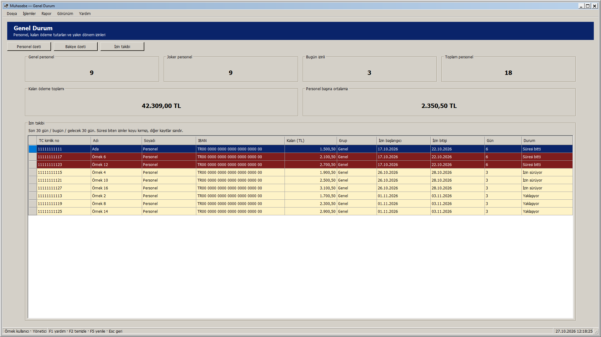
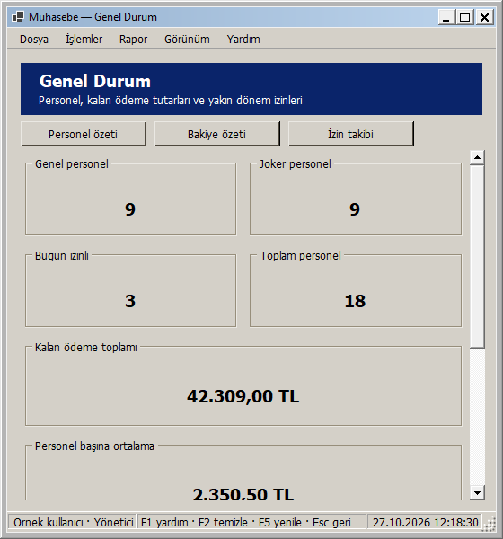
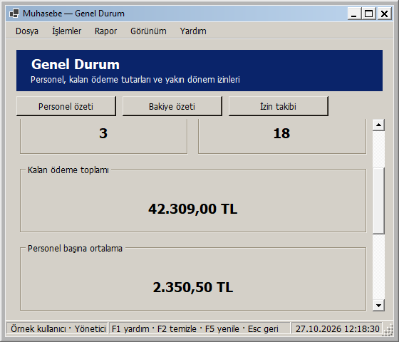
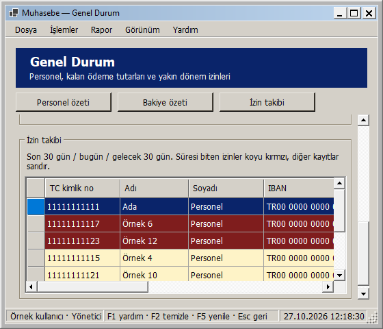

# Genel Durum: pencere boyutuna uyarlanan yerleşim

27 Ekim 2026 — Windows 2000 görünümü korunarak Genel Durum ekranı uyarlanabilir hale getirildi.

- Genel/Joker personel, bugün izinli ve toplam personel kartları geniş alanda dört, dar alanda iki sütuna geçer.
- Kalan ödeme toplamı ve personel başına ortalama kartları geniş alanda yan yana, dar alanda alt alta yerleşir. Uzun tutarların metin boyutu karta göre ayarlanır; sayısal değer, işaret ve ondalık basamaklar değiştirilmez. Tam değer erişilebilirlik açıklamasında da korunur.
- İzin listesi kalan yüksekliği doldurur. Sütunlar geniş alana yayılır; dar pencerede okunabilir minimum genişlik korunur ve tablonun kendi yatay kaydırması kullanılır. Sütun sırası/görünürlüğü tercihleri korunur; dolgu modunda sütunlar alanı birlikte paylaşır.
- Kısa/dar pencerede içerik dikey kayar. Üst başlık ile Personel özeti, Bakiye özeti ve İzin takibi düğmeleri görünür kalır; veri yenilemeden ilgili bölüme geçer. İzin listesindeki renk açıklaması genişliğe göre satır kırar.
- En küçük pencere 560 × 480 mantıksal pikseldir; çok geniş ekranlarda içerik 1760 mantıksal piksel ile sınırlandırılır. Ölçüler DPI ile ölçeklenir.

Yeniden boyutlandırmada aynı özet etiketleri ve bağlı izin tablosu korunur; yeni sorgu çalışmaz. Personel sayımı, tekrarlanan izinlerde toplamların şişmesini önleyen mevcut hesaplamalar, ortalama, 30 günlük izin aralığı, durum metinleri ve kırmızı/sarı işaretleme değiştirilmedi. Özgün seçim/sürüm, rol ve oturum akışları sürer; tablo salt okunurdur. Önceden giderilmiş turuncu açılış ekranı koruması da sürer.

## Gerçek uygulama önizlemeleri

Geniş pencere:

Dar pencerede personel özeti:

Dar pencerede bakiye özeti:

Dar pencerede izin takibi:

Görseller yayımlanan yerel DLL'den, örnek kullanıcı/Genel/Joker personel verileri ve gerçek DisplaySummary hesaplamasıyla WinForms çiziminden üretildi. Önizlemelerde gerçek personel kayıtları kullanılmadı/değiştirilmedi.

## Doğrulama

**303 veritabanısız test başarılı; 0 başarısız, 0 atlanan.** Release derlemesi 0 uyarı / 0 hata. Kanıt: `artifacts/analysis/master-20261027-121613-287/master.trx`.

Yeni üç rol testi 26 genişliği iki yönde toplam **156 boyutlandırma durumu** ile denetler. Kartların sütun değiştirmesi, çakışmaması, değerlerin tam sığması, aynı toplamların/izin satırlarının/sıralanmış seçimin korunması kontrol edilir. Tek personelin iki izin satırı örneğiyle toplamın değişmemesi de doğrulanır. En küçük pencerede her bölüme geçiş, açıklamanın satır kırması, büyütünce kaydırmanın kalkması, gizli sürümler ve salt okunur tablo kontrol edilir.

Ayrı bir test, decimal en büyük/en küçük tutarını beş genişlikte ve klasik/açık/koyu temada **30 durum** ile denetler; toplam ve ortalama metinleri basamakları değişmeden etiketlerine tam sığar. Bu testin yakaladığı yazı tipi değişiminde etiketin varsayılan boyutuna dönmesi sorunu, dock sırasında iç içe boyutlandırma yerine kart yerleşimi sonunda açık ölçü atanarak giderildi.

Yayımlanan DLL ile yönetici/personel sorumlusu/görüntüleyici rollerinde yedi gerçek pencere boyutu (1920 × 1080, 1366 × 768, 1136 × 734, 900 × 700, 800 × 600, 560 × 600, 560 × 480) olmak üzere **21 görsel yerleşim kontrolü** başarılı. Boyutlar çerçeve dahil kaydedilir. Metinlerin sığması, çakışmayan paneller, sayfada yatay taşma olmaması, her bölüme erişim ve toplam/seçim korunması denetlenir. Kanıt: `artifacts/analysis/summary-adaptive/layout-checks.json` ve aynı klasördeki PNG'ler.

Ortam 96 DPI'dır; farklı fiziksel DPI/monitör bu adımda ayrıca denenmedi. Yeni SQL betiği/şema yükseltmesi gerekmez. Bu ekranın yerel geliştirme adımında GitHub'a push veya Release yapılmadı; toplu kaynak gönderimi için [responsive arayüzler](RESPONSIVE_ARAYUZLER.md) belgesine bakın.

## Kendiniz deneyin

1. Muhasebe - Güncel kısayolundan giriş yapıp Genel Durum ekranını açın.
2. Pencereyi daraltın/genişletin; sayım kartlarının dört/iki sütuna, bakiye kartlarının yan yana/alt alta düzene geçtiğini gözleyin.
3. Dar pencerede Personel özeti, Bakiye özeti ve İzin takibi düğmelerini deneyin. Özetlerdeki sayılar ve tutarlar boyut değişiminde korunur.
4. İzin listesinde bir satır seçip yeniden boyutlandırın; seçimin ve durum renklerinin korunduğunu gözleyin. Verileri yenilemek için mevcut F5 işlevi kullanılabilir.

Yerel paket: `artifacts/releases/summary-adaptive/`. Kabul edilen ana ekran/Genel/Joker Personel/Kişi Arama düzenleri ve önceki güvenlik/izin/ödeme/yedek düzeltmelerini de içerir.

Yerel dağıtım: Muhasebe - Güncel kısayolunun önceki bağlantısı yedeklendi ve hedef summary-adaptive paketine geçirildi. Mevcut appsettings.json birebir korundu. Computer Use ile yeni paket masaüstü oturumunda açıldı; giriş ekranındaki hazır bildirimi ve startup ready kaydı doğrulandı. Uygulama kullanıcının giriş yapması için açık bırakıldı. Kanıt: artifacts/analysis/summary-adaptive/deployment.json ve verification.json.
