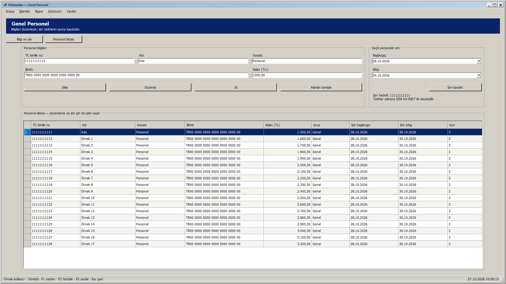
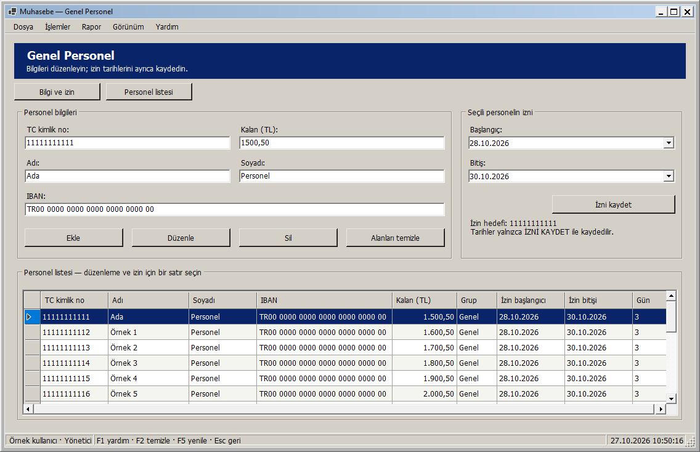
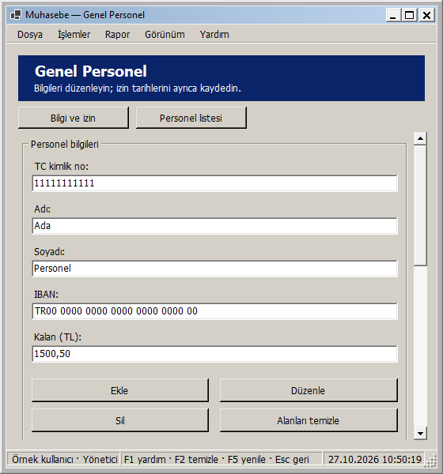
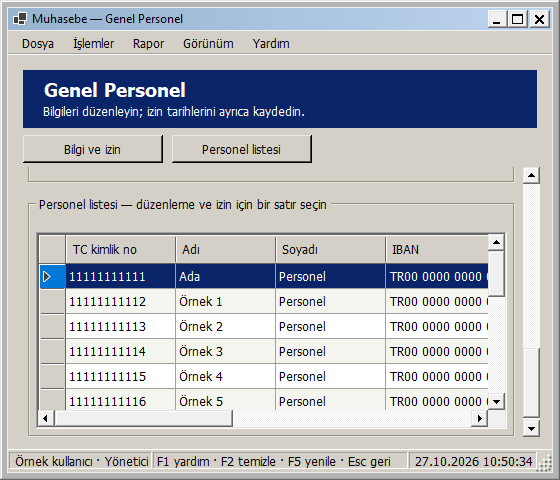

# Genel Personel: pencere boyutuna uyarlanan yerleşim

27 Ekim 2026 — Windows 2000 görünümü korunarak Genel Personel ekranı uyarlanabilir hale getirildi.

- Geniş alanda personel bilgileri ve seçili personelin izin bölümü yan yana; dar alanda alt alta yerleşir.
- Personel alanları kendi kullanılabilir genişliğine göre bir, iki veya üç sütuna geçer. Dar pencerede işlem düğmeleri iki sıraya bölünür. IBAN alanı geniş düzenlerde birden çok sütunu kullanır.
- İzin tarihleri izin bölümünün genişliğine göre yan yana veya alt alta durur. Kaydetme düğmesinin yüksekliği sabittir; seçili personel ve ayrı izin kaydı açıklaması görünür tutulur.
- Liste kalan yüksekliği kullanır. Sütunlar geniş alana yayılır; dar alanda okunabilir minimum genişliklerini korur ve tablonun kendi yatay kaydırması kullanılır. Sütun sırası/görünürlüğü tercihleri ve özgün bağlı satır korunur. Dolgu modunda sütun genişlikleri alanı birlikte paylaşır.
- Kısa/dar pencerede içerik dikey kayar; üst başlık ve Bilgi ve izin / Personel listesi geçiş düğmeleri sabit kalır. Bu düğmeler kayıt seçmez, alan temizlemez veya veri kaydetmez.
- Pencere en az 560 × 480 mantıksal piksel olur. İçerik genişliği çok geniş ekranlarda 1760 mantıksal piksel ile sınırlandırılır. Ölçüler DPI ile ölçeklenir.

Yerleşim mevcut kontrolleri taşır. Yeniden boyutlandırmada veri yeniden yüklenmez; seçili personel, henüz kaydedilmeyen alanlar, izin tarihleri ve özgün kayıt/izin sürümleri korunur. Rol kısıtları, yeni personelde izin alanlarının pasif olması, ayrı İzni kaydet işlemi, eski seçim korumaları ve mevcut ekle/düzenle/sil akışı sürer. Joker Personel yerleşimi bu adımda değiştirilmedi.

## Önizlemeler

Geniş pencere:

Normal pencere:

Dar pencere:

Dar pencerede Personel listesi düğmesiyle listeye geçiş:

Görseller gerçek yayımlanan yerel DLL ile örnek kullanıcı/personel verileri kullanılarak WinForms çiziminden üretildi. Gerçek personel kayıtlarına yazılmadı.

## Doğrulama

**293 veritabanısız test başarılı; 0 başarısız, 0 atlanan.** Release derlemesi 0 uyarı / 0 hata. Kanıt: `artifacts/analysis/master-20261027-104806-263/master.trx`.

Yeni üç rol testi 26 genişliği iki yönde, toplam **156 yeniden boyutlandırma durumu** ile denetler. Ayrıca en küçük pencerede listeye/alanlara geçiş, klavye odağıyla kaydırma, yeniden büyütmede eski kaydırmanın kalkması, açık/koyu temada izin açıklamasının sığması doğrulanır. Testler seçim kimliği, özgün sürümler, kaydedilmemiş ad/izin tarihleri ve görüntüleyicinin işlem kısıtlarını da kontrol eder.

Yayımlanan DLL ile yönetici/personel sorumlusu/görüntüleyici rollerinde 1920 × 1080, 1366 × 768, 1136 × 734, 900 × 700, 800 × 600, 560 × 600 ve 560 × 480 olmak üzere **21 görsel yerleşim kontrolü** başarılı. Panellerin çakışmaması, kontrollerin kapsayıcılarına sığması, sayfada yatay taşma olmaması, listeye erişim, gizli sürüm sütunları ve seçim korunması denetlendi. Kanıt: `artifacts/analysis/general-adaptive/layout-checks.json` ve aynı klasördeki PNG dosyaları. Bu boyutlar çerçeve dahil gerçek pencere ölçüleridir.

Doğrulama ortamı 96 DPI'dır; farklı fiziksel DPI/monitör ortamı bu adımda ayrıca denenmedi.

## Kendiniz deneyin

1. Muhasebe - Güncel kısayolundan giriş yapıp Genel Personel ekranını açın.
2. Bir satır seçin; ad alanına kaydetmeden bir metin yazıp pencereyi daraltın/genişletin. Metin ve seçimin korunmasını gözleyin.
3. Dar pencerede Personel listesi, ardından Bilgi ve izin düğmesini deneyin. Alanlar arasında Tab ile ilerleyince odaktaki alan görünür kalır.
4. Pencereyi büyütün; bilgi/izin bölümlerinin yan yana, alanların daha fazla sütunda ve listenin kalan alanı dolduracak şekilde yerleştiğini gözleyin.

Yerel paket: `artifacts/releases/general-adaptive/`. Ana ekranın kabul edilen uyarlanabilir düzeni ve önceki güvenlik/izin/ödeme/yedek düzeltmeleri de pakettedir. Yeni şema yoktur. Bu ekranın yerel geliştirme adımında GitHub'a push veya Release yapılmadı; toplu kaynak gönderimi için [responsive arayüzler](RESPONSIVE_ARAYUZLER.md) belgesine bakın.

Yerel dağıtım: Muhasebe - Güncel kısayolunun önceki bağlantısı yedeklendi ve hedef general-adaptive paketine geçirildi. Mevcut appsettings.json birebir korundu. Computer Use ile yeni paket masaüstü oturumunda açıldı; giriş ekranındaki hazır bildirimi ve startup ready kaydı doğrulandı. Uygulama kullanıcının giriş yapması için açık bırakıldı. Kanıt: artifacts/analysis/general-adaptive/deployment.json ve verification.json.
