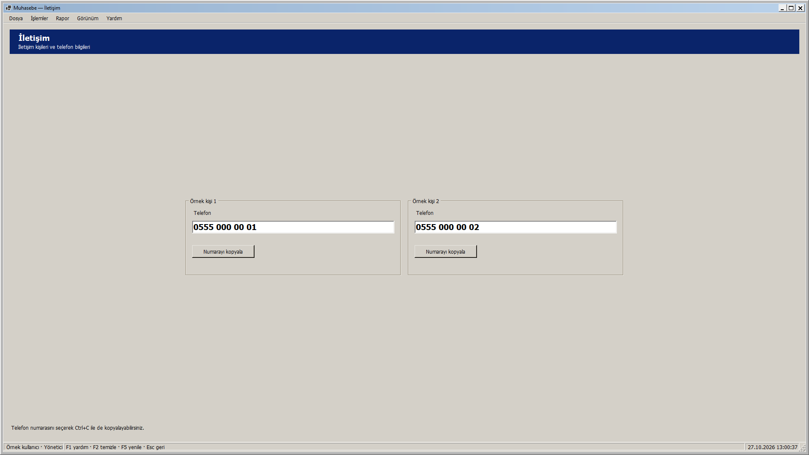
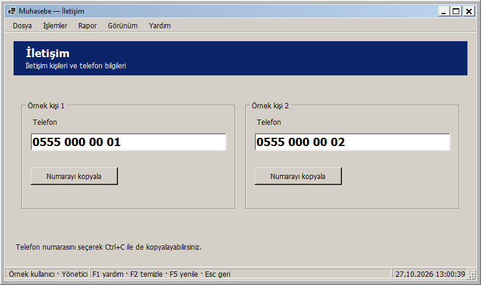
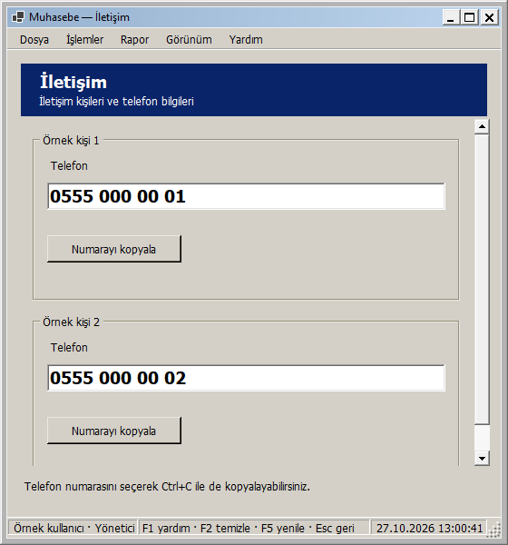
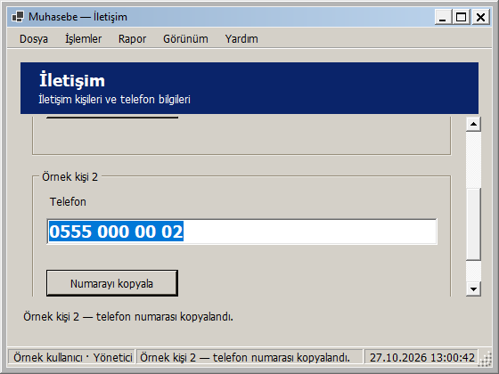

# İletişim: pencere boyutuna uyarlanan yerleşim

27 Ekim 2026 — Windows 2000 görünümü korunarak İletişim ekranı uyarlanabilir hale getirildi.

- İki iletişim kartı geniş alanda yan yana, dar alanda alt alta yerleşir. Kartlar kullanılabilir alanda ortalanır; çok geniş ekranlarda içerik 1040 mantıksal piksel ile sınırlandırılır.
- Kartlar ve kopyalama düğmeleri gereksiz yere dikey büyümez. Telefon alanları kartla genişler; numaralar büyük yazıyla gösterilir, salt okunur ve seçilebilir kalır.
- Kısa/dar pencerede içerik dikey kayar. Telefon ve kopyalama düğmesine Tab ile geçilince odaktaki kontrol görünür kalır.
- Üst başlık ve alttaki açıklama/bildirim alanı sabit kalır. Kopyalama sonucu ve pano kullanılamadığında gösterilen mesaj hem mevcut durum çubuğunda hem satır kırabilen alt alanda görünür.
- En küçük pencere 560 × 420 mantıksal pikseldir. Varsayılan içerik 800 × 400'dür; menü, durum çubuğu ve pencere çerçevesi buna eklenir. Ölçüler DPI ile ölçeklenir.

Mevcut kişi adları, telefon numaraları, salt okunurluk ve Numarayı kopyala davranışı korunur. Pencere boyutu değiştirilirken alanlar yeniden oluşturulmaz ve numara/seçili metin değişmez. Telefon seçilip Ctrl+C ile de kopyalanabilir. Yönetici, personel sorumlusu ve görüntüleyici mevcut iletişim bilgilerine erişebilir.

## Gerçek uygulama önizlemeleri

Geniş pencere:

Normal pencere:

Dar pencere:

En küçük pencerede ikinci karta klavyeyle ulaşma ve örnek kopyalama bildirimi:

Görseller yayımlanan yerel DLL'den, örnek kişi adları ve örnek numaralarla gerçek WinForms çiziminden üretildi. Örnek veriler yalnızca test pencerelerinde kullanıldı; uygulamanın mevcut iletişim bilgileri değiştirilmedi.

## Doğrulama

**306 veritabanısız test başarılı; 0 başarısız, 0 atlanan.** Release derlemesi 0 uyarı / 0 hata. Kanıt: `artifacts/analysis/master-20261027-125608-597/master.trx`.

Yeni üç rol testi, 26 genişliği iki yönde toplam **156 boyutlandırma durumu** ile denetler. Kartların yan yana/alt alta geçmesi, çakışmaması, telefon/düğmelerin sığması, uluslararası biçimli örnek numaraların ve seçili metnin korunması doğrulanır. En küçük pencerede her telefon/düğmeye odakla erişim, büyütünce kaydırmanın kalkması, açık/koyu tema ve kopyalama başarı/hata mesajlarının sığması da kontrol edilir.

Kopyalama hedefi testte yerel bir kayıt işleviyle değiştirilir; başarı ve ExternalException hata yolu denenir. Üretimde aynı Clipboard.SetText kullanılır. **Testler ve önizlemeler gerçek panoyu okumaz/değiştirmez.** Gerçek sistem panosuyla Ctrl+C/Numarayı kopyala uçtan uca işlemi bu adımda ayrıca denenmedi.

Yayımlanan DLL ile üç rolde yedi gerçek pencere boyutu (1920 × 1080, 1366 × 768, 816 × 484, 800 × 600, 720 × 600, 560 × 600, 560 × 420) olmak üzere **21 görsel yerleşim kontrolü** başarılı. Ölçüler çerçeve dahil kaydedilir. Sayfada yatay taşma, çakışan kart veya kesilen numara yoktur; iki kopyalama düğmesine erişim ve örnek kopyalama çağrısı da doğrulanır. Kanıt: `artifacts/analysis/contact-adaptive/layout-checks.json` ve aynı klasördeki PNG'ler.

Ortam 96 DPI'dır; farklı fiziksel DPI/monitör bu adımda ayrıca denenmedi. Yeni SQL betiği/şema yükseltmesi gerekmez. Bu ekranın yerel geliştirme adımında GitHub'a push veya Release yapılmadı; toplu kaynak gönderimi için [responsive arayüzler](RESPONSIVE_ARAYUZLER.md) belgesine bakın.

## Kendiniz deneyin

1. Muhasebe - Güncel kısayolundan giriş yapıp İletişim ekranını açın.
2. Pencereyi daraltın/genişletin; kartların yan yana ve alt alta düzene geçmesini gözleyin.
3. Dar/kısa pencerede Tab ile telefon ve Numarayı kopyala düğmeleri arasında ilerleyin; ikinci karta kaydırılarak ulaşılır.
4. Numarayı kopyala düğmesini veya numarayı seçip Ctrl+C yolunu deneyin. Düğmeden kopyalama sonucu alt bildirim alanında da görünür.

Yerel paket: `artifacts/releases/contact-adaptive/`. Kabul edilen önceki uyarlanabilir ekranlar ile güvenlik/izin/ödeme/yedek düzeltmelerini de içerir.

Yerel dağıtım: Muhasebe - Güncel kısayolunun önceki bağlantısı yedeklendi ve hedef contact-adaptive paketine geçirildi. Mevcut appsettings.json birebir korundu. Computer Use ile yeni paket masaüstü oturumunda açıldı; startup ready kaydı ve güncel paketin ana ekranı doğrulandı. Kullanıcı oturumu açık bırakıldı. Kanıt: artifacts/analysis/contact-adaptive/deployment.json ve verification.json.
