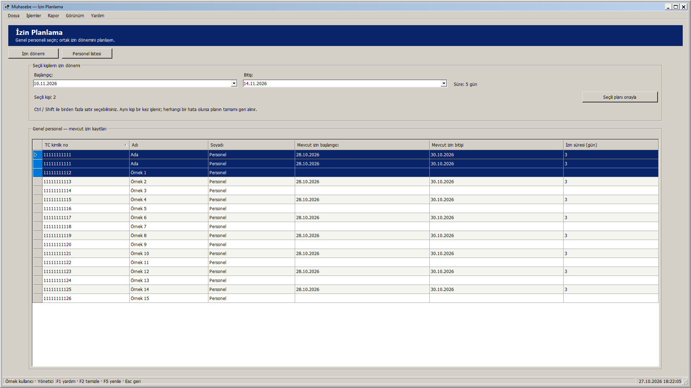
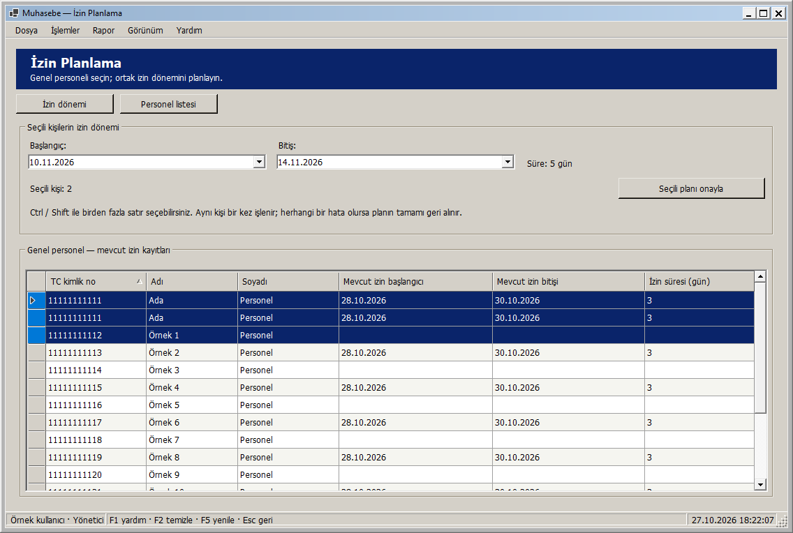
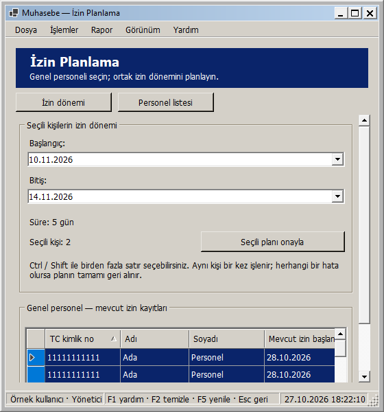
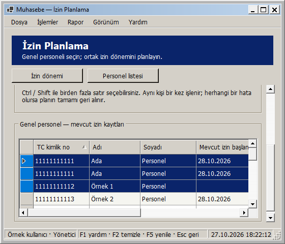
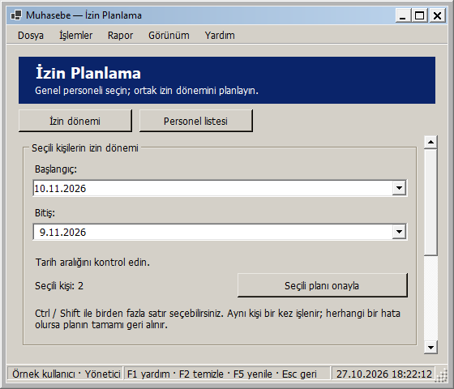

# İzin Planlama: pencere boyutuna uyarlanan yerleşim

27 Ekim 2026 — Windows 2000 görünümü korunarak İzin Planlama ekranı uyarlanabilir hale getirildi.

- Başlangıç ve bitiş tarihleri geniş bölümde yan yana, dar bölümde alt alta yerleşir. En geniş düzende süre bilgisi tarihlerle aynı sıradadır; daha dar alanda ayrı sıraya geçer.
- Seçili kişi sayısı ve planı onaylama düğmesi aynı sırada hizalanır. Onay düğmesi sabit boyutunu korur. Çoklu seçim açıklaması satır kırar ve gereken yüksekliği alır.
- Personel listesi kalan yüksekliği doldurur. Sütunlar geniş alanı paylaşır; dar pencerede okunabilir minimum genişliklerini korur ve tablonun kendi yatay kaydırması kullanılır.
- Kısa pencerede içerik dikey kayar. Sabit üstteki İzin dönemi ve Personel listesi düğmeleri ilgili bölüme erişir; klavye odağıyla alanlara geçişte de içerik kaydırılır.
- En küçük pencere 560 × 480 mantıksal pikseldir. Çok geniş ekranda içerik 1760 mantıksal piksel ile sınırlanıp ortalanır. Ölçüler DPI ile ölçeklenir.

Boyut değişiminde aynı tarih alanları ve personel tablosu kullanılır. Kaydedilmemiş tarihler, süre/uyarı bilgisi, sıralanmış çoklu seçim ve özgün TC/RecordVersion/LeaveVersion bilgileri korunur. Tekrarlanan satırlar kişi sayısını şişirmez. Düzen değişikliği sorgu, izin kaydı veya onay penceresi çalıştırmaz. Görüntüleyici için onay düğmesi kapalı kalır. Bu adımda LeavePlanForm.cs içindeki kaydetme, yenileme, transaction ve sürüm koruması işleyicileri değiştirilmedi.

## Önizlemeler

Tam ekran:

Normal pencere:

Dar pencere:

Dar pencerede liste:

Ters tarih aralığındaki mevcut uyarı:

Görseller yayımlanan yerel DLL ile gerçek WinForms çiziminden üretildi. Kişiler, mevcut izinler ve plan tarihleri örnek veridir. Aynı kişinin tekrarlanan satırları seçili olsa da kişi sayısı özgün TC üzerinden hesaplanır.

## Doğrulama

**346 veritabanısız test başarılı; 0 başarısız, 0 atlanan.** Release derlemesi ve Windows paketi 0 uyarı / 0 hata. Kanıt: `artifacts/analysis/master-20261027-181937-228/master.trx`.

Yeni dokuz yerleşim testi; yönetici, personel sorumlusu ve görüntüleyici rollerinde geçerli, aynı gün ve ters tarih aralıklarını denetler. Her biri 26 genişliği iki yönde, toplam **468 boyutlandırma durumu** ile kontrol eder. Panel/alan/metin sığması, üç yerleşim geçişi, çoklu seçim, iki özgün kişinin üç satırdan doğru sayılması, veri kaynağı/kontrol kimlikleri, tarihler ve rol kısıtları doğrulanır. Görüntüdeki TC, personel/izin sürümü ve izin tarihi değiştirilmiş örnek satırda bile özgün seçim sürümlerinin korunması ayrıca denetlenir. Minimum boyutta liste/alanlara erişim, büyütünce kaydırmanın kalkması ve açık/koyu temada açıklamaların sığması da kontrol edilir.

Yayımlanan DLL ile üç rol × yedi pencere boyutu (1920 × 1080, 1366 × 900, 1136 × 764, 1000 × 740, 800 × 600, 560 × 600, 560 × 480), toplam **21 görsel yerleşim kontrolü** başarılı. Boyutlar çerçeve dahildir. Kanıt: `artifacts/analysis/leave-plan-adaptive/layout-checks.json` ve aynı klasördeki PNG'ler. Yayımlanan paket, RID derlemesi ve görsel yardımcı aynı DLL özetine sahiptir.

Denemelerde gerçek veritabanı kullanılmadı; izin kaydetme/onay işlemi yapılmadı. Kontroller 96 DPI ortamındadır; farklı fiziksel DPI/monitör ayrıca denenmedi. Yeni SQL betiği yok; Bu ekranın yerel geliştirme adımında GitHub'a push veya Release yapılmadı; toplu kaynak gönderimi için [responsive arayüzler](RESPONSIVE_ARAYUZLER.md) belgesine bakın.

## Kendiniz deneyin

1. Muhasebe - Güncel kısayolundan giriş yapıp İzin planı ekranını açın.
2. Ctrl / Shift ile birden fazla personel satırı seçip, onaylamadan başlangıç/bitiş tarihlerini değiştirin.
3. Pencereyi büyütün, daraltın ve kısaltın; tarihler, gün sayısı, seçili kişi sayısı ve seçili satırlar korunur.
4. Dar pencerede İzin dönemi / Personel listesi düğmelerini ve tablo içindeki yatay kaydırmayı deneyin.
5. Aynı gün için süre bir gündür. Bitişi başlangıçtan önce seçince mevcut tarih uyarısı görünür. Bu yerleşim denemesi için Seçili planı onayla düğmesine basmanız gerekmez.

Yerel paket: `artifacts/releases/leave-plan-adaptive/`. Önceki uyarlanabilir ekranları ve güvenlik/izin/ödeme/yedek düzeltmelerini de içerir. Dağıtım ve açılış doğrulaması: `artifacts/analysis/leave-plan-adaptive/deployment.json` ve `verification.json`.
