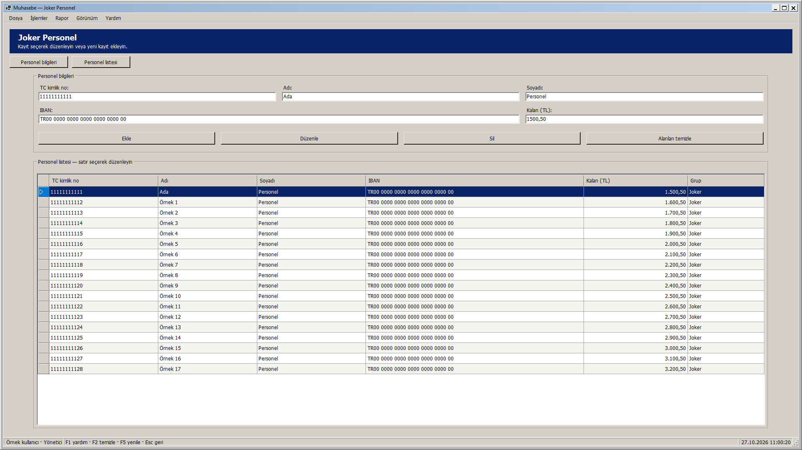
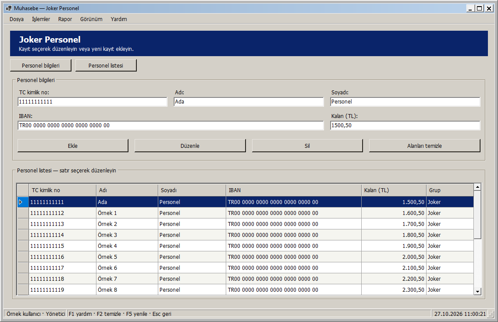
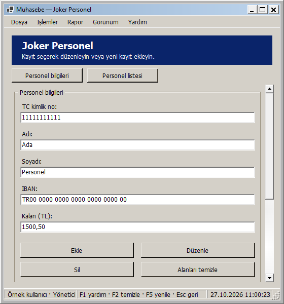
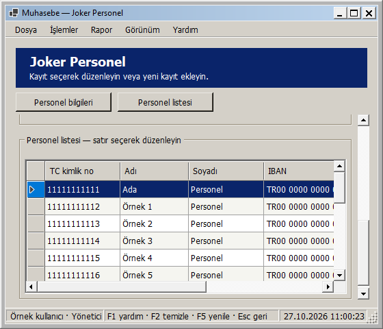

# Joker Personel: pencere boyutuna uyarlanan yerleşim

27 Ekim 2026 — Windows 2000 görünümü korunarak Joker Personel ekranı uyarlanabilir hale getirildi.

- Personel alanları kullanılabilir genişliğe göre bir, iki veya üç sütuna geçer. IBAN alanı geniş düzenlerde birden çok sütunu kullanır; dar pencerede alanlar alt alta sıralanır.
- Ekle, Düzenle, Sil ve Alanları temizle düğmeleri dar alanda iki sıraya bölünür. Düğme yüksekliği ve okunabilir metin genişlikleri korunur.
- Liste kalan yüksekliği doldurur; sütunlar geniş alana yayılır. Dar pencerede minimum okunabilir sütun genişlikleri korunur ve tablonun kendi yatay kaydırması kullanılır. Kaydedilen sütun sırası/görünürlüğü sürer; dolgu modunda sütunlar kullanılabilir alanı paylaşır.
- Kısa/dar pencerede içerik dikey kayar. Üst başlık ile Personel bilgileri / Personel listesi düğmeleri görünür kalır; bu düğmeler kayıt seçmeden veya alanları temizlemeden ilgili bölüme gider.
- Pencerenin alt sınırı 560 × 480 mantıksal pikseldir; çok geniş ekranlarda içerik 1760 mantıksal piksel ile sınırlanır. Ölçüler DPI ile ölçeklenir.

Personel alanı, Genel Personel'deki mevcut düzen kodu ortak PersonnelEditor bileşenine taşınarak kullanılır. Genel Personel'in görünümü ve davranışı korunur. Yeniden boyutlandırmada mevcut kontroller taşınır; veri yeniden yüklenmez, seçili kayıt ve kaydedilmemiş alanlar korunur. Joker tablosunda yalnızca altı personel sütunu gösterilir; özgün TC ve RecordVersion bağlı DataRow'da kalır. İzin kontrolleri/sütunları eklenmez. Rol kısıtları ve eski seçim/sürüm korumaları sürer.

## Gerçek uygulama önizlemeleri

Geniş pencere:

Normal pencere:

Dar pencere:

Dar pencerede Personel listesi düğmesiyle listeye geçiş:

Görseller yayımlanan yerel DLL'den, örnek kullanıcı/personel kayıtlarıyla gerçek WinForms çiziminden üretildi. Gerçek personel kayıtlarına yazılmadı.

## Doğrulama

**296 veritabanısız test başarılı; 0 başarısız, 0 atlanan.** Release derlemesi 0 uyarı / 0 hata. Kanıt: `artifacts/analysis/master-20261027-105712-389/master.trx`. Ortak bileşeni kullanan Genel Personel testleri de bu çalışmada geçti.

Joker için yeni üç rol testi 26 genişliği iki yönde, toplam **156 boyutlandırma durumu** ile denetler. Sütun geçişleri, çakışmayan paneller, kapsayıcıya sığan alanlar ve okunabilir düğmeler; sıralanmış tablodaki özgün TC/sürüm ve kaydedilmemiş ad/IBAN alanlarının korunması doğrulanır. Ayrıca en küçük pencerede listeye/bilgilere geçiş, alan odağıyla kaydırma, yeniden büyütmede kaydırmanın kalkması, açık/koyu tema ve Alanları temizle ile seçimin/alanların temizlenmesi kontrol edilir. Görüntüleyicide kayıt değiştiren düğmeler pasif kalır.

Yayımlanan DLL ile yönetici/personel sorumlusu/görüntüleyici rollerinde yedi pencere boyutu (1920 × 1080, 1366 × 768, 1136 × 734, 900 × 700, 800 × 600, 560 × 600, 560 × 480) olmak üzere **21 görsel yerleşim kontrolü** başarılı. Gerçek ölçüler çerçeve dahil kaydedilir; sayfada yatay taşma, kesilen kontrol veya çakışan panel yoktur. Listeye erişim ve seçim korunması ayrıca denetlendi. Kanıt: `artifacts/analysis/joker-adaptive/layout-checks.json` ve aynı klasördeki PNG'ler.

Ortam 96 DPI'dır; farklı fiziksel DPI/monitör bu adımda ayrıca denenmedi. Yeni SQL betiği veya şema yükseltmesi gerekmez. Bu ekranın yerel geliştirme adımında GitHub'a push veya Release yapılmadı; toplu kaynak gönderimi için [responsive arayüzler](RESPONSIVE_ARAYUZLER.md) belgesine bakın.

## Kendiniz deneyin

1. Muhasebe - Güncel kısayolundan giriş yapıp Joker Personel ekranını açın.
2. Bir kayıt seçin; ad veya IBAN alanını kaydetmeden değiştirip pencereyi daraltın/genişletin. Seçimin ve alan değerlerinin korunmasını gözleyin.
3. Dar pencerede Personel listesi ve Personel bilgileri düğmelerini deneyin. Tab ile ilerlerken odaktaki alan görünür kalır.
4. Pencereyi büyütün; alanların daha fazla sütuna geçmesini ve listenin kalan alanı doldurmasını gözleyin. Alanları temizle, seçimi kaldırıp yeni kayıt için alanları boşaltır.

Yerel paket: `artifacts/releases/joker-adaptive/`. Kabul edilen ana ekran/Genel Personel düzenleri ile önceki güvenlik/izin/ödeme/yedek düzeltmelerini de içerir.

Yerel dağıtım: Muhasebe - Güncel kısayolunun önceki bağlantısı yedeklendi ve hedef joker-adaptive paketine geçirildi. Mevcut appsettings.json birebir korundu. Computer Use ile yeni paket masaüstü oturumunda açıldı; giriş ekranındaki hazır bildirimi ve startup ready kaydı doğrulandı. Uygulama kullanıcının giriş yapması için açık bırakıldı. Kanıt: artifacts/analysis/joker-adaptive/deployment.json ve verification.json.
