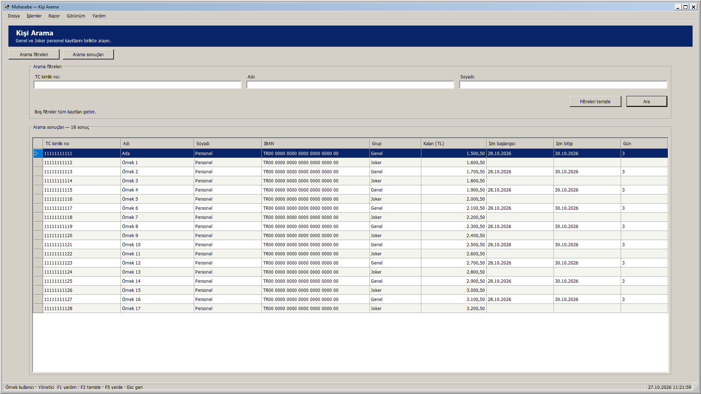
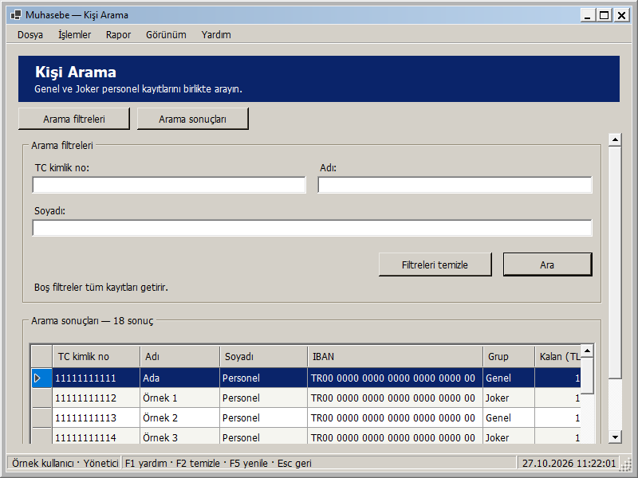
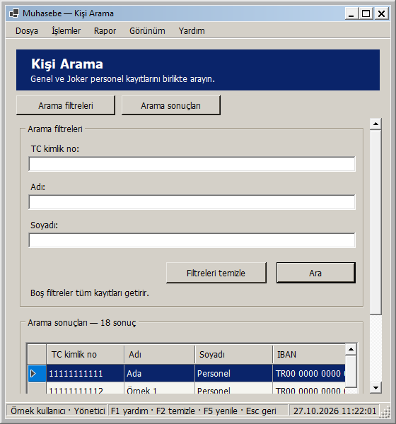
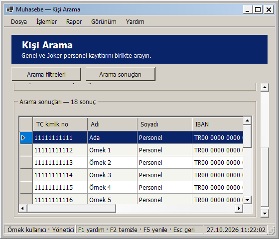

# Kişi Arama: pencere boyutuna uyarlanan yerleşim

27 Ekim 2026 — Windows 2000 görünümü korunarak Kişi Arama ekranı uyarlanabilir hale getirildi.

- TC kimlik no, ad ve soyad alanları kullanılabilir genişliğe göre bir, iki veya üç sütuna geçer. İki sütunlu düzende soyad alanı ikinci satırı kullanır.
- Ara ve Filtreleri temizle düğmeleri okunabilir genişlikte, sabit yükseklikte kalır; filtre bölümünün sağ altına hizalanır. Boş filtrelerin tüm kayıtları getirdiğini açıklayan kısa not bölümün içinde görünürdür.
- Sonuç listesi kalan yüksekliği doldurur. Sütunlar geniş alana yayılır; dar pencerede okunabilir minimum genişlik korunur ve tablonun kendi yatay kaydırması kullanılır. Sütun sırası/görünürlüğü tercihleri korunur; dolgu modunda sütunlar alanı birlikte paylaşır.
- Kısa/dar pencerede içerik dikey kayar. Üst başlık ve Arama filtreleri / Arama sonuçları düğmeleri görünür kalır. Bu düğmeler sorgu çalıştırmadan, alanları veya seçimi değiştirmeden ilgili bölüme gider.
- En küçük pencere 560 × 480 mantıksal pikseldir. Çok geniş ekranlarda içerik 1760 mantıksal piksel ile sınırlandırılır. Ölçüler DPI ile ölçeklenir.

Yeniden boyutlandırmada aynı alanlar ve bağlı tablo korunur: girilmiş filtreler, mevcut sonuçlar, sıralanmış seçimin özgün TC/sürümü değişmez ve yeni arama tetiklenmez. Genel/Joker arama sorgusu ve sonuç sayısı akışı değiştirilmedi. Enter ve F5 arar; F2 veya Filtreleri temizle alanları boşaltıp TC alanına odaklanır. Filtreleri temizlemek mevcut sonuçları değiştirmez; yeniden aramak için Ara/Enter/F5 kullanılır. Sonuçlar salt okunur kalır ve mevcut rol/oturum kontrolleri sürer.

## Gerçek uygulama önizlemeleri

Geniş pencere:

Orta pencere:

Dar pencere:

Dar pencerede Arama sonuçları düğmesiyle listeye geçiş:

Görseller yayımlanan yerel DLL ile örnek Genel/Joker kayıtları kullanılarak gerçek WinForms çiziminden üretildi. Önizleme verileri ve sonuç başlığı fixture içinde atandı; gerçek veritabanında arama/yazma yapılmadı.

## Doğrulama

**299 veritabanısız test başarılı; 0 başarısız, 0 atlanan.** Release derlemesi 0 uyarı / 0 hata. Kanıt: `artifacts/analysis/master-20261027-111843-958/master.trx`.

Yeni üç rol testi, 26 genişliği iki yönde toplam **156 boyutlandırma durumu** ile denetler. Filtrelerin sütun değiştirmesi, çakışmayan paneller, kapsayıcıya sığan alan/düğmeler, aynı veri kaynağı, korunmuş filtreler ve özgün seçimin sürümü kontrol edilir. Ayrıca en küçük pencerede sonuçlara/filtrelere geçiş, alan odağıyla kaydırma, yeniden büyütmede kaydırmanın kalkması, açık/koyu tema, Enter varsayılan düğmesi ve temizlemenin mevcut tabloyu/kişileri değiştirmemesi doğrulanır. Üç rol de mevcut salt okunur aramaya erişebilir; iç sürüm sütunları gizli kalır.

Yayımlanan DLL ile yönetici/personel sorumlusu/görüntüleyici rollerinde yedi pencere boyutu (1920 × 1080, 1366 × 768, 1136 × 734, 900 × 700, 800 × 600, 560 × 600, 560 × 480) olmak üzere **21 görsel yerleşim kontrolü** başarılı. Gerçek ölçüler çerçeve dahil kaydedilir. Sayfada yatay taşma, kesilen kontrol veya çakışan panel yoktur; listeye erişim ve seçimin korunması denetlenir. Kanıt: `artifacts/analysis/search-adaptive/layout-checks.json` ve aynı klasördeki PNG'ler.

Ortam 96 DPI'dır; farklı fiziksel DPI/monitör bu adımda ayrıca denenmedi. Yeni SQL betiği/şema yükseltmesi gerekmez. Bu ekranın yerel geliştirme adımında GitHub'a push veya Release yapılmadı; toplu kaynak gönderimi için [responsive arayüzler](RESPONSIVE_ARAYUZLER.md) belgesine bakın.

## Kendiniz deneyin

1. Muhasebe - Güncel kısayolundan giriş yapıp Kişi Arama ekranını açın.
2. Bir arama yapın; ardından filtre metnini değiştirip henüz Ara'ya basmadan pencereyi daraltın/genişletin. Yeni metin ve önceki sonuçların korunmasını gözleyin.
3. Dar pencerede Arama sonuçları ve Arama filtreleri düğmelerini deneyin. Alanlar arasında Tab ile ilerleyin.
4. Filtreleri temizle veya F2 ile alanları boşaltın; mevcut sonuçlar korunur. Enter ile yeni arama yapılır.
5. Pencereyi büyütün; filtrelerin daha fazla sütuna geçmesini ve sonuç listesinin kalan alanı doldurmasını gözleyin.

Yerel paket: `artifacts/releases/search-adaptive/`. Kabul edilen ana ekran/Genel/Joker Personel düzenleri ile önceki güvenlik, izin, ödeme ve yedek düzeltmelerini de içerir.

Yerel dağıtım: Muhasebe - Güncel kısayolunun önceki bağlantısı yedeklendi ve hedef search-adaptive paketine geçirildi. Mevcut appsettings.json birebir korundu. Computer Use ile yeni paket masaüstü oturumunda açıldı; giriş ekranındaki hazır bildirimi ve startup ready kaydı doğrulandı. Uygulama kullanıcının giriş yapması için açık bırakıldı. Kanıt: artifacts/analysis/search-adaptive/deployment.json ve verification.json.
