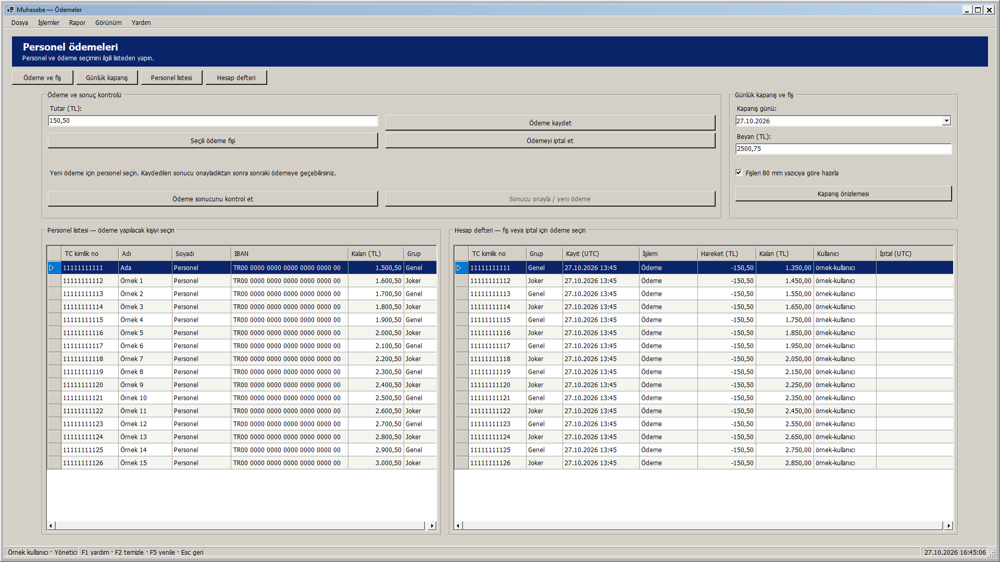
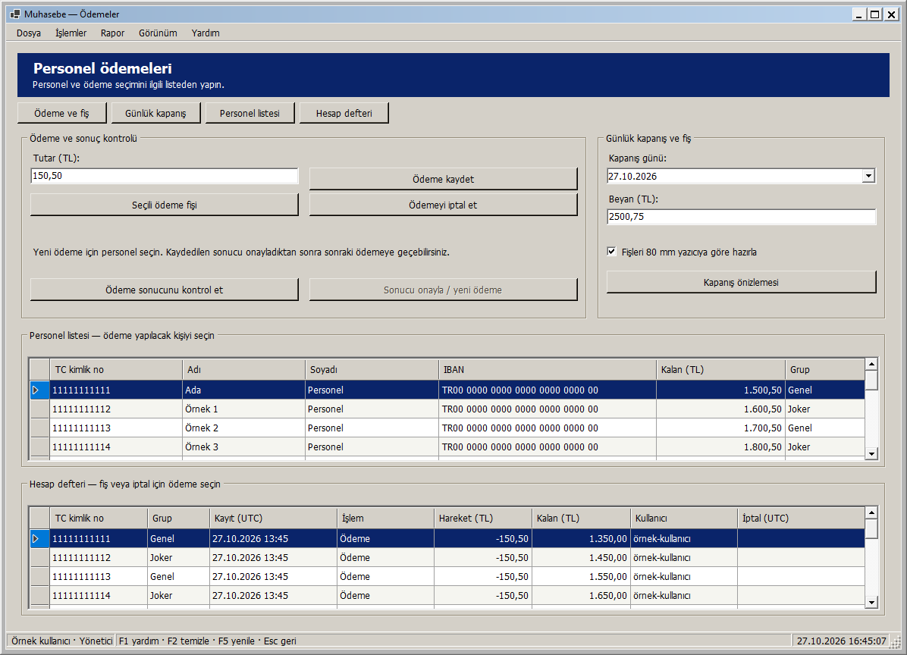
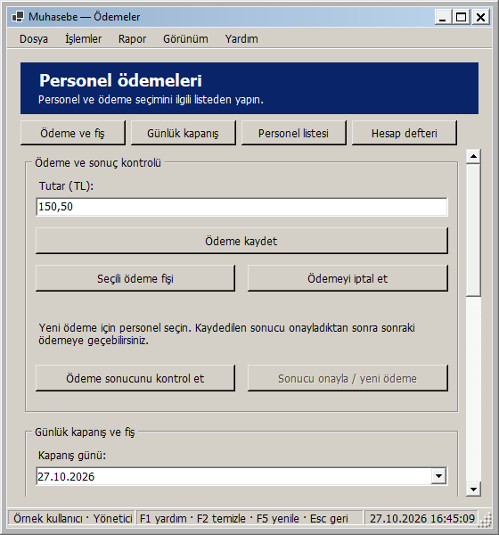
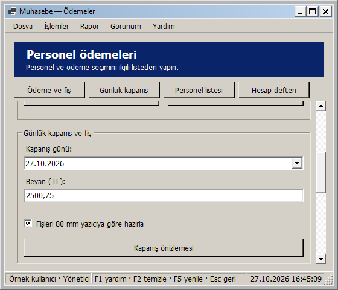
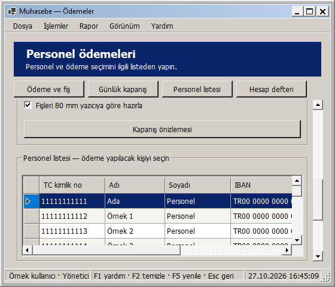
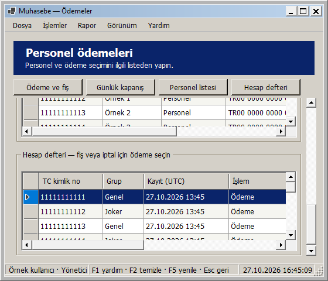
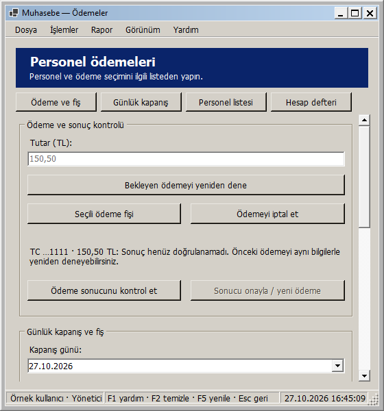

# Ödemeler: pencere boyutuna uyarlanan yerleşim

27 Ekim 2026 — Windows 2000 görünümü korunarak Ödemeler ekranı uyarlanabilir hale getirildi.

- Ödeme ve günlük kapanış bölümleri geniş alanda yan yana, dar alanda alt alta yerleşir. Tutar/kaydetme ve kapanış alanları kendi bölümlerinin genişliğine göre hizalanır; düğmelerin yüksekliği sabittir.
- Personel ve hesap defteri listeleri çok geniş pencerede yan yana, diğer boyutlarda alt alta yerleşir ve kalan yüksekliği paylaşır. Sütunlar geniş alanı doldurur; dar alanda okunabilir minimum genişliklerini korur, tablonun kendi yatay kaydırması kullanılır.
- Ödeme sonucu açıklaması satır kırar ve uzunluğuna göre bölümü büyütür. Kısa pencerede sayfa dikey kayar. Sabit üst düğmeler ödeme, günlük kapanış, personel ve hesap defteri bölümlerine doğrudan erişir; alanlara klavyeyle geçildiğinde de içerik kaydırılır.
- En küçük pencere 560 × 480 mantıksal pikseldir. Çok geniş ekranda içerik 1760 mantıksal piksel ile sınırlanıp ortalanır. Ölçüler DPI ile ölçeklenir.

Yeniden boyutlandırmada aynı kontroller ve bağlı tablolar kullanılır. Girilmiş tutar/beyan, kapanış günü, 80 mm seçimi, sıralanmış personel/defter seçimi ve özgün ödeme RequestId'si korunur. Düzen değişimi sorgu, ödeme, sonuç kontrolü, onay, iptal veya yazdırma çalıştırmaz. Belirsiz ödeme için tutar/personel kilidi, yeniden deneme/onay ayrımı ve rol kısıtları mevcut iş akışında kalır. Ödeme, fiş ve kapanış servisleri bu arayüz değişikliği için değiştirilmedi.

## Önizlemeler

Tam ekran:

Normal pencere:

Dar pencere:

Dar pencerede günlük kapanış:

Dar pencerede personel ve hesap defteri:

Belirsiz ödeme durumu:

Görseller yayımlanan yerel DLL ile gerçek WinForms çiziminden üretildi. Kişiler, tutarlar, geçmiş ödemeler ve kullanıcılar örnek veridir.

## Doğrulama

**326 veritabanısız test başarılı; 0 başarısız, 0 atlanan.** Release derlemesi ve Windows paketi 0 uyarı / 0 hata. Kanıt: `artifacts/analysis/master-20261027-163957-710/master.trx`.

Yeni 15 test; yönetici, personel sorumlusu ve görüntüleyici rollerinde yeni/belirsiz/kaydedilmiş/iptal edilmiş/reddedilmiş ödeme durumlarını denetler. Her biri 26 genişliği iki yönde, toplam **780 boyutlandırma durumu** ile kontrol eder. Panellerin çakışmaması, alan/düğme sığması, personel/defter seçimi ve veri kaynağı kimliği, tutar/tarih/fiş tercihi, bekleyen ödeme nesnesi, roller ve etkin/pasif kontrollerin değişmemesi doğrulanır. Minimum boyutta bölüm geçişleri ve alanlara kaydırmayla erişim, açık/koyu temada sonuç açıklamasının sığması da kontrol edilir.

Yayımlanan DLL ile üç rolde yedi pencere boyutu (1920 × 1080, 1366 × 900, 1196 × 864, 1000 × 740, 800 × 600, 560 × 600, 560 × 480), toplam **21 görsel yerleşim kontrolü** başarılı. Boyutlar çerçeve dahildir. Kanıt: `artifacts/analysis/payments-adaptive/layout-checks.json` ve aynı klasördeki PNG'ler. DLL özeti yayımlanan paket, RID derlemesi ve görsel kontrol yardımcısında aynıdır.

Gerçek veritabanı kullanılmadı; ödeme/iptal/sonuç onayı/kontrol sorgusu veya rapor düğmeleri çalıştırılmadı. Fiziksel yazdırma yapılmadı. Kontroller 96 DPI ortamındadır; farklı fiziksel DPI/monitör ayrıca denenmedi. Yeni SQL betiği yok; Bu ekranın yerel geliştirme adımında GitHub'a push veya Release yapılmadı; toplu kaynak gönderimi için [responsive arayüzler](RESPONSIVE_ARAYUZLER.md) belgesine bakın.

## Kendiniz deneyin

1. Muhasebe - Güncel kısayolundan giriş yapıp Ödemeler ekranını açın.
2. Pencereyi büyütün, daraltın ve kısaltın; bölümler ve listeler yeniden yerleşir.
3. Ödeme kaydetmeden tutar/beyan girip kapanış gününü ve fiş seçeneğini değiştirin. Pencereyi yeniden boyutlandırınca bu değerler korunur.
4. Personel ve hesap defterinden birer satır seçip pencere boyutunu değiştirin; seçimler korunur.
5. Dar pencerede üstteki dört bölüm düğmesini ve Tab ile alanlara geçişi deneyin. Bu yerleşim denemesi için ödeme, iptal veya onay işlemi yapmanız gerekmez.

Yerel paket: `artifacts/releases/payments-adaptive/`. Önceki uyarlanabilir ekranları ve güvenlik/izin/ödeme/yedek düzeltmelerini de içerir. Dağıtım ve açılış doğrulaması: `artifacts/analysis/payments-adaptive/deployment.json` ve `verification.json`.
