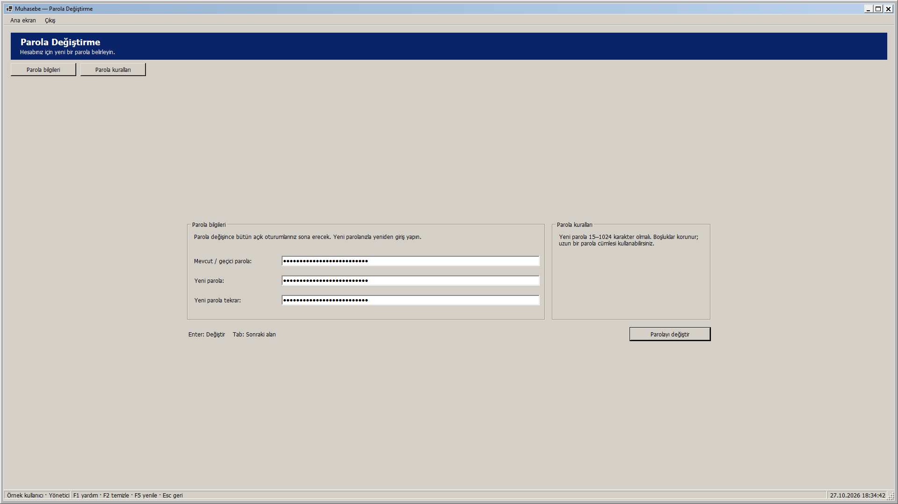
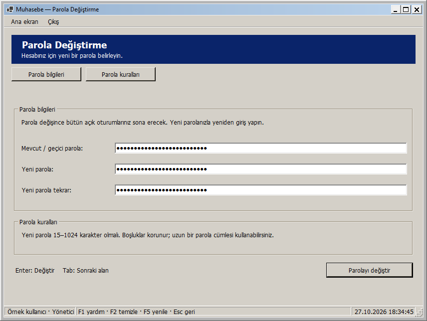
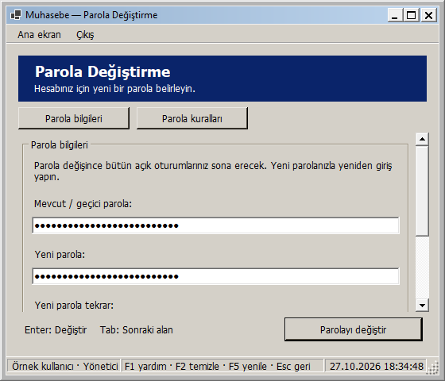
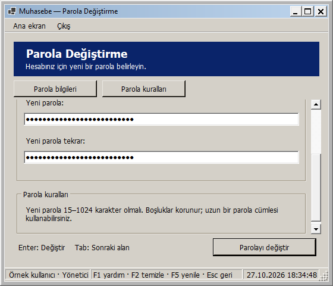

# Parola Değiştirme: pencere boyutuna uyarlanan yerleşim

27 Ekim 2026 — Windows 2000 görünümü korunarak Parola Değiştirme ekranı uyarlanabilir hale getirildi.

- Parola bilgileri ve kurallar geniş alanda yan yana, dar alanda alt alta yerleşir. Alan açıklamaları bölüm genişliğine göre parolanın solunda veya üstünde görünür.
- Alanlar, kurallar ve işlem düğmesi yeterli alanda birlikte ortalanır; içerik 1120 mantıksal piksel ile sınırlanır. Tam ekranda alanlar gereksiz yere uzamaz ve işlem düğmesi formdan uzaklaşmaz.
- Kısa pencerede alanlar/kurallar dikey kayar. Parolayı değiştir düğmesi görünür kalır. Üstteki Parola bilgileri / Parola kuralları düğmeleri ve Tab ile alanlara geçiş, görünmeyen bölümlere erişim sağlar.
- Normal ve geçici parola oturumlarının açıklamaları satır kırar ve gereken yüksekliği alır. Parola kuralları aynı metni gösterir.
- En küçük pencere 560 × 480 mantıksal pikseldir. Ölçüler DPI ile ölçeklenir.

Boyut değişiminde aynı üç parola kutusu ve aynı işlem düğmesi kullanılır. Girilen karakterler, baştaki/sondaki boşluklar, karakter seçimi, parola maskesi ve 1024 karakter sınırı korunur. Enter aynı düğmeye bağlıdır; Tab sırası mevcut/geçici parola → yeni parola → tekrar → değiştir şeklindedir.

Görüntüleyici ve geçici parola oturumları kendi parolalarını değiştirebilir. Geçici parola oturumunda ana ekrana geçiş kısıtı ve sade çıkış menüsü sürer. İşlem sırasında mevcut giriş kilitleri korunur. Boyutlandırma/bölüm geçişi parola göndermez, hesaba yazmaz veya oturumu kapatmaz. Parola Değiştirme işleyicileri bu adımda değiştirilmedi; işlemden ve form kapanışından sonra alanların temizlenmesi, başarılı değişimde yeniden giriş akışı aynı kalır.

## Önizlemeler

Tam ekran:

Normal pencere:

Dar pencere:

Dar pencerede kurallar:

Geçici parola oturumu:

Görseller yayımlanan yerel DLL ile gerçek WinForms çiziminden üretildi. Oturumlar ve maskeli alandaki değerler örnektir; gerçek kullanıcı parolası kullanılmadı. Parolayı değiştir düğmesine basılmadı.

## Doğrulama

**352 veritabanısız test başarılı; 0 başarısız, 0 atlanan.** Release derlemesi ve Windows paketi 0 uyarı / 0 hata. Kanıt: `artifacts/analysis/master-20261027-183224-481/master.trx`.

Yeni altı yerleşim testi, üç rol × normal/geçici parola oturumlarını denetler. Her biri boşta ve işlem kilidi etkinken 26 genişliği iki yönde, toplam **624 boyutlandırma durumu** ile kontrol eder. Maskeli alanların kimliği, 1024 karakterlik örnek değer/boşluk/karakter seçiminin korunması, oturum nesnesi/sürümü, açıklama/kuralların sığması, etkin/pasif kontroller ve işlem düğmesinin bütün atalarda görünür olması doğrulanır. İşlem kilidi gerçek RunOperationAsync ile yerel bekleme görevi kullanılarak denenir; parola servisi çağrılmaz. Küçük pencerede alanlara/bölümlere erişim, Tab sırası, Enter düğmesi, açık/koyu tema ve kapanışta alan temizleme de kontrol edilir.

Yayımlanan DLL ile üç rol × iki oturum türü × yedi pencere boyutu (1920 × 1080, 1366 × 900, 856 × 644, 1000 × 740, 800 × 600, 560 × 600, 560 × 480), toplam **42 görsel yerleşim kontrolü** başarılı. Bu görseller klasik temadadır. Boyutlar çerçeve dahildir. Kanıt: `artifacts/analysis/password-change-adaptive/layout-checks.json` ve aynı klasördeki PNG'ler. Yayımlanan paket, RID derlemesi ve görsel yardımcı aynı DLL özetine sahiptir.

Denemelerde gerçek veritabanı kullanılmadı; parola gönderimi/değişimi veya kimlik bilgisi kaydetme yapılmadı. Kontroller 96 DPI ortamındadır; farklı fiziksel DPI/monitör ayrıca denenmedi. Yeni SQL betiği yok; Bu ekranın yerel geliştirme adımında GitHub'a push veya Release yapılmadı; toplu kaynak gönderimi için [responsive arayüzler](RESPONSIVE_ARAYUZLER.md) belgesine bakın.

## Kendiniz deneyin

1. Muhasebe - Güncel kısayolundan giriş yapıp Dosya → Parolamı değiştir ekranını açın.
2. Değiştirme düğmesine basmadan örnek metinler girin; pencereyi büyütün, daraltın ve kısaltın. Alan değerleri ve maskeleme korunur.
3. Dar pencerede Parola bilgileri / Parola kuralları düğmelerini, kaydırmayı ve Tab ile üç alan/düğme arasındaki sırayı deneyin.
4. Parolayı değiştir düğmesi kısa pencerede de görünür kalır. Yerleşimi denemek için bu düğmeye veya Enter'a basmanız gerekmez.
5. Ana ekrana dönün veya formu kapatın; tekrar açıldığında parola alanları boştur. Geçici parola oturumundaysanız mevcut zorunlu değiştirme akışı sürer.

Yerel paket: `artifacts/releases/password-change-adaptive/`. Önceki uyarlanabilir ekranları ve güvenlik/izin/ödeme/yedek düzeltmelerini de içerir. Dağıtım ve açılış doğrulaması: `artifacts/analysis/password-change-adaptive/deployment.json` ve `verification.json`.
