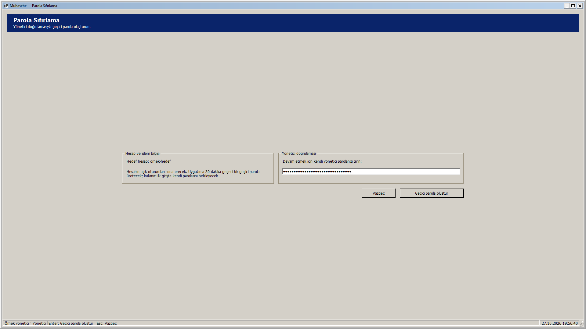
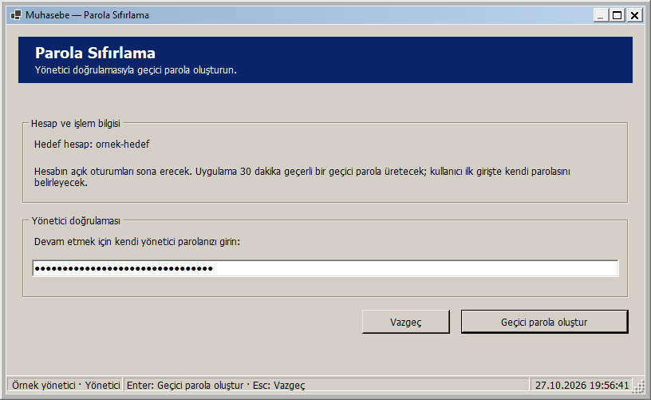
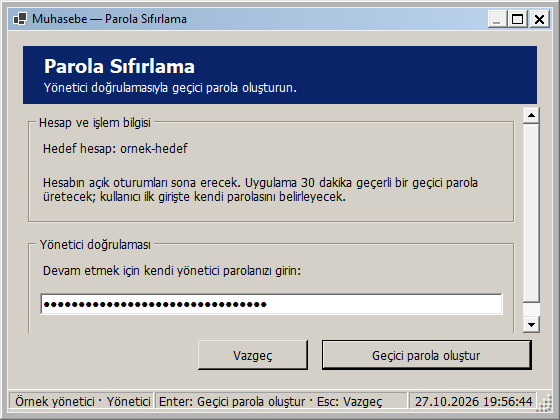
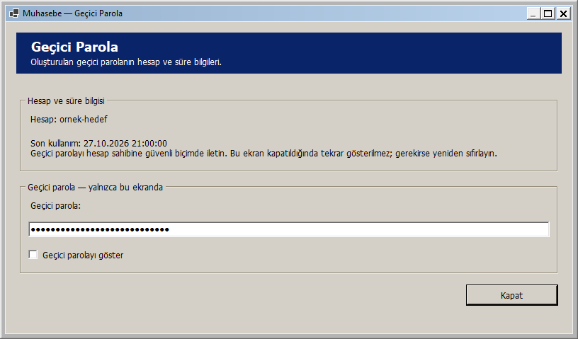
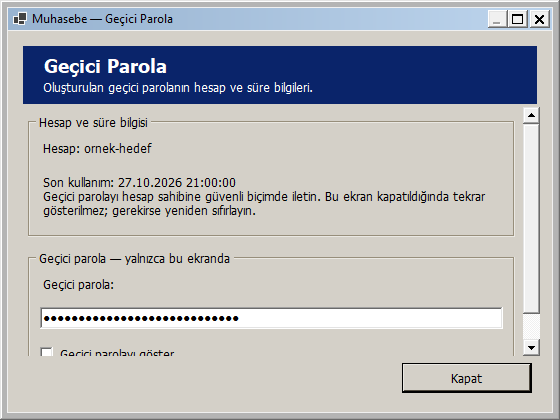

# Parola Sıfırlama: pencere boyutuna uyarlanan yerleşim

27 Ekim 2026 — Windows 2000 görünümü korunarak Parola Sıfırlama ve aynı akıştaki Geçici Parola sonuç penceresi uyarlanabilir hale getirildi.

- İki pencere de yeniden boyutlandırılabilir ve büyütülebilir. En küçük pencere 560 × 420 mantıksal pikseldir; küçültme düğmesi kapalı kalır.
- Hesap/işlem bilgisi ile parola alanı geniş pencerede yan yana, dar pencerede alt alta yerleşir. İçerik ve işlem düğmeleri birlikte ortalanır; genişlik 1120 mantıksal piksel ile sınırlanır.
- Hedef kullanıcı adı başlıktaki dar bir satır yerine bilgi bölümünde gösterilir. Uzun adlar ve açıklamalar satır kırar. Kullanıcı adındaki `&` gibi karakterler olduğu gibi gösterilir.
- Kısa pencerede bilgi ve parola bölümleri dikey kayar. Vazgeç/Geçici parola oluştur veya Kapat düğmeleri görünür kalır. Parola alanına ve gösterme seçeneğine klavyeyle geçildiğinde içerik kaydırılır.
- Geçici parola sonuç penceresinde hesap adı, son kullanım zamanı ve mevcut açıklama korunur. Parola salt okunur ve başlangıçta maskelidir; mevcut gösterme seçeneği boyut değişiminde aynı durumda kalır.
- Ölçüler DPI ile ölçeklenir. Normal pencere başlangıcında bütün alan ve düğmeler görünürdür.

Boyut değişiminde aynı parola kutusu, düğmeler ve gösterme seçeneği kullanılır. Girilmiş yönetici parolası, boşluklar ve karakter seçimi; maskeleme ve 1024 karakter sınırı; hedef hesap bilgisi ve sonuç süresi korunur. Enter/Esc, vazgeçme ve kapanışta parola alanını temizleme davranışı sürer. İşlem sırasında mevcut giriş kilitleri korunur. Sıfırlama işleyicileri ve özgün AccountTarget sürümü/epoch'u kullanan servis akışı bu adımda değiştirilmedi. Yerleşim değişikliği parola sıfırlamaz veya yeni parola üretmez.

## Önizlemeler

Tam ekran sıfırlama:

Normal sıfırlama penceresi:

Dar sıfırlama penceresi:

Geçici parola sonucu:

Dar sonuç penceresinde parola alanına erişim:

Görseller yayımlanan yerel DLL ile gerçek WinForms çiziminden üretildi. Hesaplar, süre ve maskeli parolalar örnektir; gerçek parola sıfırlanmadı. Sonuç penceresi örnek bir PasswordResetResult ile açıldı.

## Doğrulama

**364 veritabanısız test başarılı; 0 başarısız, 0 atlanan.** Release derlemesi ve Windows paketi 0 uyarı / 0 hata. Kanıt: `artifacts/analysis/master-20261027-195324-764/master.trx`.

Yeni 12 yerleşim testi klasik/açık/koyu temaları kapsar. Altı sıfırlama testi, kısa/uzun hesap adlarında boşta ve işlem kilidi etkinken 26 genişliği iki yönde toplam **624 boyutlandırma durumu** denetler. Altı sonuç penceresi testi, parola gösterme seçeneği kapalı/açıkken aynı genişliklerde **312 durum** daha denetler; toplam **936 boyutlandırma durumu** kontrol edilir.

Panellerin çakışmaması, açıklamaların sığması, düğmelerin bütün atalarda görünür kalması, aynı kontroller, yönetici parolası/karakter seçimi/maskeleme, hedef kullanıcı adı ve sürümü/epoch'u, sonuç süresi/salt okunurluk/gösterme tercihi doğrulanır. İşlem kilidi, gerçek RunOperationAsync ile yalnızca yerel bir bekleme görevi üzerinden denenir; sıfırlama servisi çağrılmaz. Minimum boyutta alanlara erişim, Tab sırası, Enter/Esc düğmeleri ve kapanışta alan temizleme de kontrol edilir.

Yayımlanan DLL ile iki pencere × üç tema × yedi boyut, toplam **42 görsel yerleşim kontrolü** başarılı. Boyutlar 1920 × 1080, 1366 × 900, normal başlangıç boyutu, 1000 × 740, 800 × 600, 560 × 520 ve 560 × 420'dir. 96 DPI ortamında çerçeve dahil normal ölçüler sıfırlama için 816 × 501, sonuç penceresi için 816 × 479 olarak kaydedildi. Kanıt: `artifacts/analysis/password-reset-adaptive/layout-checks.json` ve aynı klasördeki PNG'ler. Yayımlanan paket, RID derlemesi ve görsel yardımcı aynı DLL özetine sahiptir. Görsel kontrollerde parola alanları maskeli tutuldu.

Gerçek veritabanı, hesap veya kullanıcı parolası kullanılmadı; sıfırlama, paylaşma veya panoya yazma yapılmadı. Kontroller 96 DPI ortamındadır; farklı fiziksel DPI/monitör ayrıca denenmedi. Yeni SQL betiği yok; Bu ekranın yerel geliştirme adımında GitHub'a push veya Release yapılmadı; toplu kaynak gönderimi için [responsive arayüzler](RESPONSIVE_ARAYUZLER.md) belgesine bakın.

## Kendiniz deneyin

1. Muhasebe - Güncel kısayolundan yönetici olarak giriş yapıp Yönetici hesapları ekranını açın.
2. Hedef hesabı seçip Parolayı sıfırla penceresini açın. Parola üretmeden pencereyi büyütün, daraltın ve kısaltın.
3. Gerçek parolanız yerine örnek bir metin girerek maske ve alan değerinin boyutlandırmada korunduğunu deneyebilirsiniz. Geçici parola oluştur veya Enter'a basmadan Vazgeç/Esc ile çıkın.
4. Pencereyi tekrar açtığınızda yönetici parolası alanı boştur. Hedef hesap adı ve sıfırlamanın etkileri bilgi bölümündedir.
5. Geçici Parola sonuç penceresi gerçek bir sıfırlama tamamlanınca açılır. Yalnızca yerleşimi denemek için hesabı sıfırlamanız gerekmez; örnek sonuç önizlemeleri yukarıdadır.

Yerel paket: `artifacts/releases/password-reset-adaptive/`. Önceki uyarlanabilir ekranları ve güvenlik/izin/ödeme/yedek düzeltmelerini de içerir. Dağıtım ve açılış doğrulaması: `artifacts/analysis/password-reset-adaptive/deployment.json` ve `verification.json`.
