# Windows 2000 görünüm denemesi

25 Ekim 2026 arayüz geliştirmeleri; 26 Ekim 2026 kaynak güncellemesi. Güncel yerel paket: `artifacts/releases/windows-2000-password-reset-layout/`.

Parola Sıfırlama güncellemesi: yönetici doğrulama ve geçici parola sonucu pencereleri 720 × 330 içerik ölçüsünde, sabit çerçeveli ve hizalı düğmelerle açılır. Hedef hesap başlıkta, yönetici parolası ayrı bölümde; Vazgeç/Esc desteği vardır. Sonuç penceresinde süre açıklaması, maskeli geçici parola ve mevcut gösterme seçeneği korunur. Yerleşim, maskeleme, Esc ile vazgeçme ve mevcut parola/oturum kısıtları dahil 100 kontrol başarılı. Vazgeçildiğinde yönetici parolası temizlenir. Gerçek hesap sıfırlanmadı; belge görselleri örnek hesap/parola kullanır. Kanıt: `artifacts/analysis/password-reset-layout/password-reset-layout.trx`.

Parola Değiştirme güncellemesi: 720 × 420 içerik ölçüsü; üstte oturum açıklaması, ortada aynı hizada üç maskeli parola alanı, altta parola kuralları ve sağda değiştirme düğmesi. Mevcut/geçici parola ayrımı, Enter ile gönderme, işlem sonunda alanları temizleme ve yeniden giriş akışı korunur. Normal/küçük/büyük pencere, parola maskeleri ve mevcut parola/oturum kontrolleri dahil 99 kontrol başarılı. Gerçek parola değiştirilmedi; önizlemede yalnızca maskeli örnek değerler kullanılır. Kanıt: `artifacts/analysis/password-change-layout/password-change-layout.trx`.

İzin Planlama güncellemesi: 1120 × 610 içerik ölçüsü; üstte hizalı başlangıç/bitiş alanları, gün sayısı, seçili kişi sayısı ve onay düğmesi; altta geniş Genel personel/izin listesi. Ctrl / Shift ile çoklu seçim korunur. Aynı kişinin birden fazla izin satırı kişi sayımında bir kez değerlendirilir; özgün TC ve mevcut toplu kaydetme/onay akışı korunur. Normal/küçük/büyük pencere ve özgün kişi sayımı dahil 108 veritabanısız kontrol başarılı; gerçek izin kaydı oluşturulmadı. Kanıt: `artifacts/analysis/leave-plan-layout/leave-plan-layout.trx`.

Ayarlar güncellemesi: 980 × 650 içerik ölçüsü; bağlantı, yedekleme ve görünüm/fiş seçenekleri ayrı bölümlerde. Dosya ve klasör alanları hizalı, seçim düğmeleri sabit genişliktedir; kaydetme, yedekleme ve geri yükleme işlemleri alttadır. Mevcut profil doğrulaması, tema davranışı ve geri yükleme onayı korunur. Normal/küçük/büyük pencere, tema seçimi ve mevcut profil/yedek/oturum kontrolleri dahil 108 kontrol başarılı. Gerçek veritabanına yedekleme/geri yükleme uygulanmadı; önizleme örnek yollar içerir. Kanıt: `artifacts/analysis/settings-layout/settings-layout.trx`.

Ödemeler güncellemesi: 1180 × 740 içerik ölçüsü; solda tutar/ödeme ve sonuç kontrolü, sağda günlük kapanış ve 80 mm fiş ayarı. Altta başlıklarla ayrılmış personel listesi ve hesap defteri bulunur. IBAN ve işlem kolonları okunabilir genişliktedir, tutarlar sağa hizalıdır. Ödeme işlem kimliği görünür kolonlardan çıkarılsa da özgün bağlı kayıtta korunur. Normal, en küçük ve büyük pencere yerleşimleri; mevcut çift ödeme/kayıt seçimi/oturum korumaları gerçek ödeme göndermeden doğrulandı. 100 kontrol başarılı. Kanıt: `artifacts/analysis/payments-layout/payments-layout.trx`.

Yönetici güncellemesi: 1120 × 610 içerik ölçüsü; solda hizalı yeni hesap alanları, sağda seçili hesabın durum/sıfırlama/silme işlemleri, altta geniş hesap listesi. Parola maskesi ve mevcut hesap/oturum korumaları korunur. Yetki başlıkları Türkçedir; geçici parola bitişi UTC tarih ve saatle gösterilir. 90 görünüm/kayıt seçimi/oturum kontrolü ve son yetki gösterimiyle 17 görünüm kontrolü başarılı. Kanıt: `artifacts/analysis/admin-layout/admin-layout.trx` ve `artifacts/analysis/admin-layout/admin-final-appearance.trx`.

İletişim güncellemesi: 720 × 320 içerik ölçüsünde pencere; yan yana iki kişi kartı, büyük ve seçilebilir telefon alanları, her kartta Numarayı kopyala düğmesi. Mevcut isim ve telefonlar korunur; önizlemede örnek değerler kullanılır. 90 veritabanısız görünüm, kayıt seçimi ve oturum geçişi kontrolü başarılı. Kanıt: `artifacts/analysis/contact-layout/contact-layout.trx`.

Genel Durum açılış düzeltmesi: tasarımdan kalan turuncu arka plan ve çerçevesiz ilk pencere ayarı kaldırıldı; seçili tema pencere gösterilmeden uygulanır. 71 veritabanısız görünüm/ekran geçişi kontrolü başarılı; kanıt: `artifacts/analysis/summary-startup/summary-startup.trx`.

Genel Durum güncellemesi: üstte Genel/Joker/bugün izinli/toplam kişi sayıları, ortada kalan ödeme toplamı ve kişi başına ortalama, altta geniş izin takibi listesi. Başlıklar ve durum renklerinin açıklaması sadeleştirildi; ilk satır otomatik seçilmediği için uyarı renkleri açılışta görünür. Çoklu izin satırlarında kişi ve tutarların tekrar sayılmadığı da doğrulandı. 95 veritabanısız görünüm, özet/rapor ve ekran geçişi kontrolü başarılı; kanıt: `artifacts/analysis/summary-layout/summary-layout.trx`.

Kişi Arama güncellemesi: TC, ad ve soyad filtreleri üstte tek sırada; Ara ve Filtreleri Temizle düğmeleri sağda, sonuçlar altta tam genişliktedir. Enter aramayı başlatır; sonuç başlığında bulunan sonuç sayısı gösterilir. Pencere ölçüleri ve kolon başlıkları diğer düzenlenen ekranlarla uyumludur. 88 veritabanısız görünüm, kayıt seçimi ve oturum/ekran geçişi kontrolü başarılı; kanıt: `artifacts/analysis/search-layout/search-layout.trx`.

Joker Personel güncellemesi: üstte iki sütunlu personel bilgileri ve geniş IBAN alanı, altta tam genişlikte liste. Ekle/düzenle/sil/temizle tek sıradadır. Liste Joker'in personel alanlarına bağlanır; bu ekranda kullanılmayan izin kolonları gösterilmez. Sıralama sonrasında özgün TC/sürüm bilgisinin korunması dahil 45 veritabanısız kontrol başarılı; kanıt: `artifacts/analysis/joker-layout/joker-layout.trx`.

Genel Personel güncellemesi: üstte yan yana personel bilgileri ve izin bölümü, altta tam genişlikte liste. IBAN alanı genişletildi; ekle/düzenle/sil/temizle aynı sırada hizalandı. Liste başlıkları sadeleştirildi, tutarlar sağa hizalandı; kayıtlı kişisel kolon ölçüleri korunur. Görünüm ve özgün kayıt seçimiyle ilgili 44 veritabanısız kontrol başarılı; kanıt: `artifacts/analysis/general-layout/general-layout.trx`. Giriş, ana ekran ve Joker yerleşimleri bu adımda değiştirilmedi.

Ana ekran güncellemesi: daha kompakt başlangıç boyutu, genişletilmiş Bölümler ağacı ve üç düzenli işlem grubu: Personel ve izin, Ödeme ve rapor, Hesap ve destek. Düğmeler aynı yükseklikte tutulur; pencere büyüdüğünde uzayıp boşluğu doldurmaz. Grupların genişliği sınırlandırılır ve normal pencerede başlıkla hizalanır. Çıkış düğmesi alt sağdadır. Giriş ekranı önceki sabit boyutlu düzenini korur. 70 görünüm/oturum kontrolü ve son hizalama sonrasında 15 görünüm kontrolü başarılı; kanıtlar: `artifacts/analysis/dashboard-layout/`.

Kullanıcı geri bildirimiyle giriş ekranı sabit boyutlu pencereye dönüştürüldü. Dıştaki mavi çalışma alanı kaldırıldı; pencere 620 × 400 iç alanla doğrudan giriş içeriğine oturtuldu. Büyütme düğmesi kapalıdır; pencere normal boyutta açılır ve kenarlardan boyutlandırılamaz. Diğer uygulama ekranları büyütülebilir. Son görünüm ve giriş hazırlığı kontrolü: 23 başarılı test; kanıt: `artifacts/analysis/login-compact/login-compact.trx`.

## Görünüm ve kullanım

- Windows 2000 tarzında sıcak gri yüzeyler, lacivert başlıklar, Tahoma yazı tipi, kabartmalı düğmeler ve çerçeveli beyaz giriş alanları.
- Giriş ekranında geniş kullanıcı/parola alanları, belirgin giriş düğmesi ve durum mesajı.
- Ana ekranda solda ağaç kısayolları; sağda klavyeyle de erişilebilen personel, ödeme, izin ve rapor düğmeleri. Yönetim kısayolları yalnızca yöneticiye gösterilir.
- Genel personelde bilgiler ve izinler üstte, liste altta tam genişliktedir. Joker personelde bilgiler üstte, sadeleştirilmiş liste alttadır. Kayıt alanları ve işlem düğmeleri özgün olaylarını kullanmaya devam eder.
- Ortak menüler: **Dosya**, **İşlemler**, **Rapor**, **Görünüm**, **Yardım**. Parola değiştirme Dosya menüsündedir; Excel/CSV aktarımı Rapor menüsündedir.
- **Görünüm → Windows 2000 · Klasik / Açık tema / Koyu tema** ile değiştirilebilir. Seçim kullanıcı tercihi olarak saklanır. Yönetici Ayarlar ekranında da klasik görünümü seçebilir.

Giriş, ana ekran ve Genel/Joker yerleşimleri yeniden düzenlendi. Diğer ekranlar ortak renk, kontrol, liste ve menü stilini kullanır; bütün ekranların yerleşimi bu ilk denemede yeniden tasarlanmadı.

## Deneyebileceklerin

1. Masaüstündeki **Muhasebe - Windows 2000 Deneme** kısayolunu açıp kendi hesabınla giriş yap.
2. Ana ekranda Tab ve Enter ile işlem düğmelerini dene. Soldaki ağaçta Genel personeli seçip menüden ana ekrana dön.
3. Personel kartında alan hizalarını, IBAN'ın okunmasını, liste seçimini ve ayrı izin bölümünü kontrol et.
4. Dosya menüsündeki parola değiştirmeyi, Rapor menüsündeki dışa aktarmayı ve Görünüm menüsündeki üç temayı incele.
5. F2 alanları temizler, F5 listeyi yeniler; personelde F6/F7 taslak kaydetme/yükleme olarak kalır. Ana ekranın normal menüsünde Ctrl+Home ana ekrana, Ctrl+Shift+Q çıkışa gider.

Bu bir görünüm denemesidir; aynı bağlantı profiliyle açıldığında mevcut veritabanını kullanır. Bu nedenle kaydetme/silme/ödeme gibi işlemler gerçek kayıtlara uygulanır. Yalnızca görünümü incelemek için veri değiştirmen gerekmez. Mevcut **Muhasebe - Güncel** kısayolu korunur.

Bu geliştirmede yeni SQL betiği yoktur. Önceki sürümlerden eksik şema yükseltmesi varsa standart giriş hazırlığı yedek alıp uygular. Parola, giriş sınırı, yetki, ödeme ve eşzamanlı kayıt korumaları korunmuştur.

## Önizlemeler

Aşağıdaki görüntüler gerçek kişi verisi içermeyen test hesapları ve örnek satırlarla oluşturuldu.

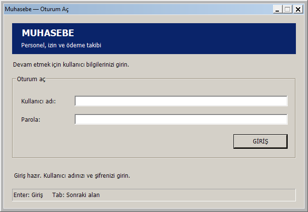

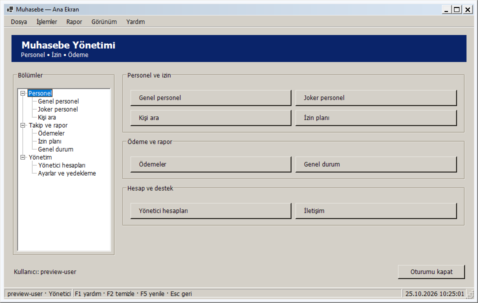

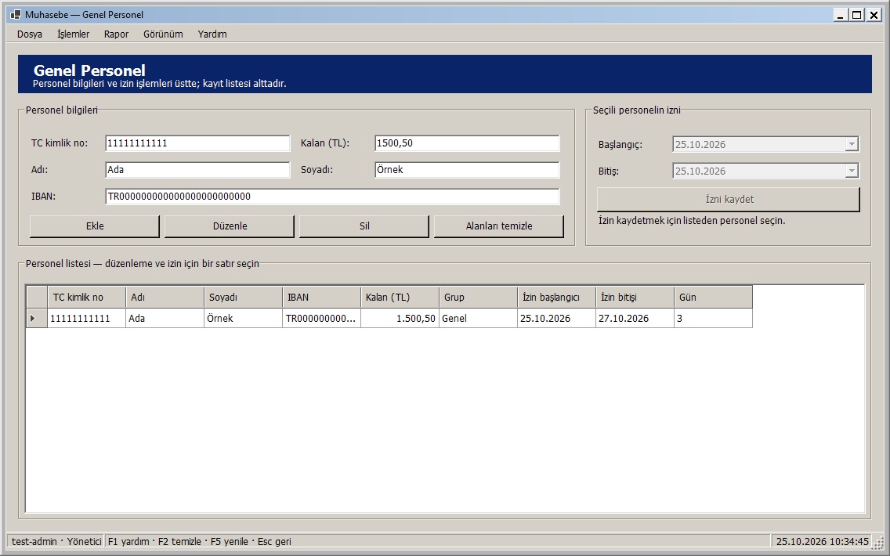

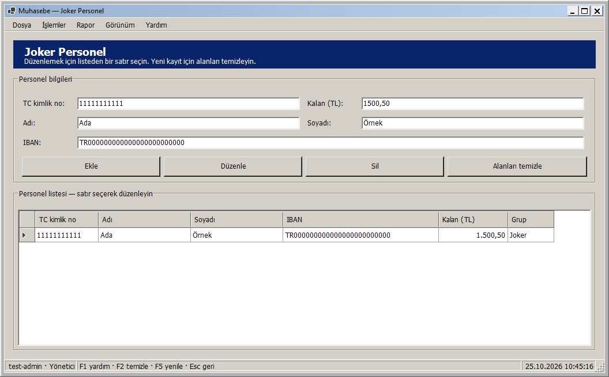

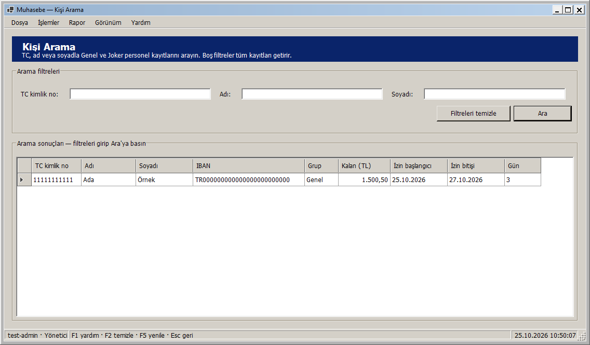

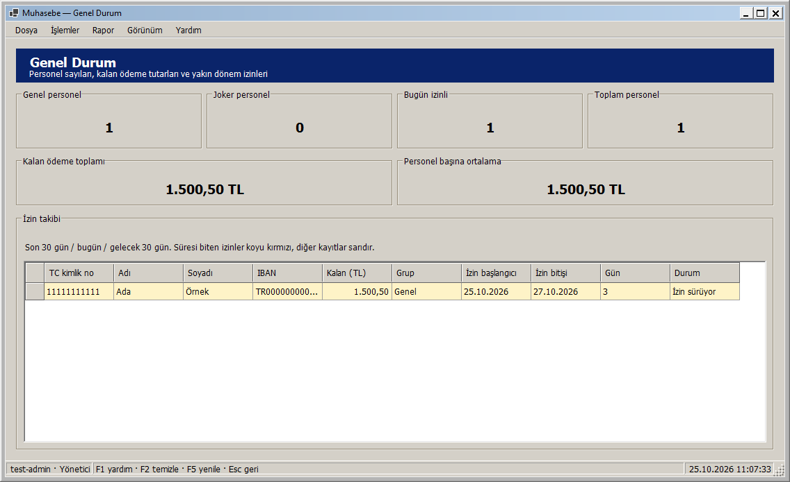

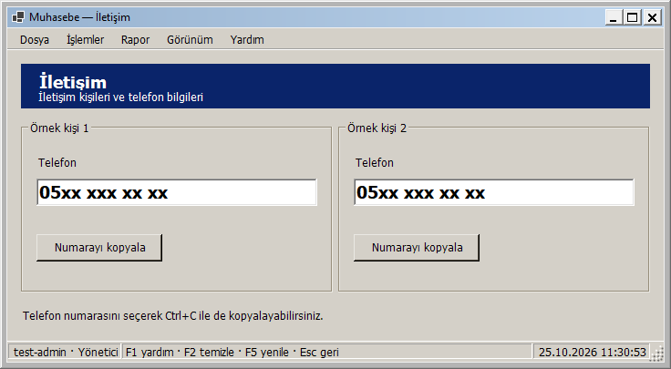

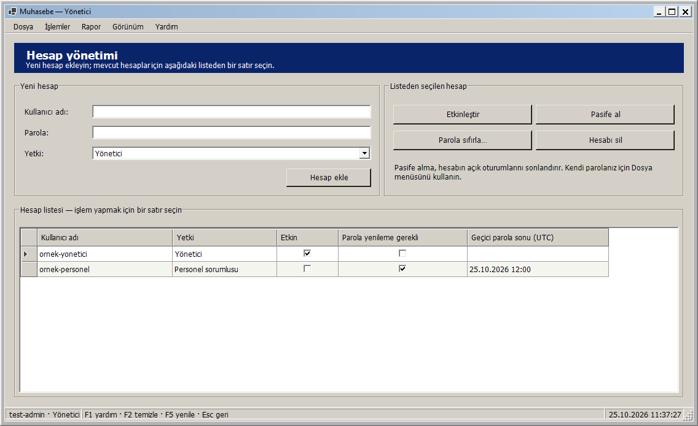

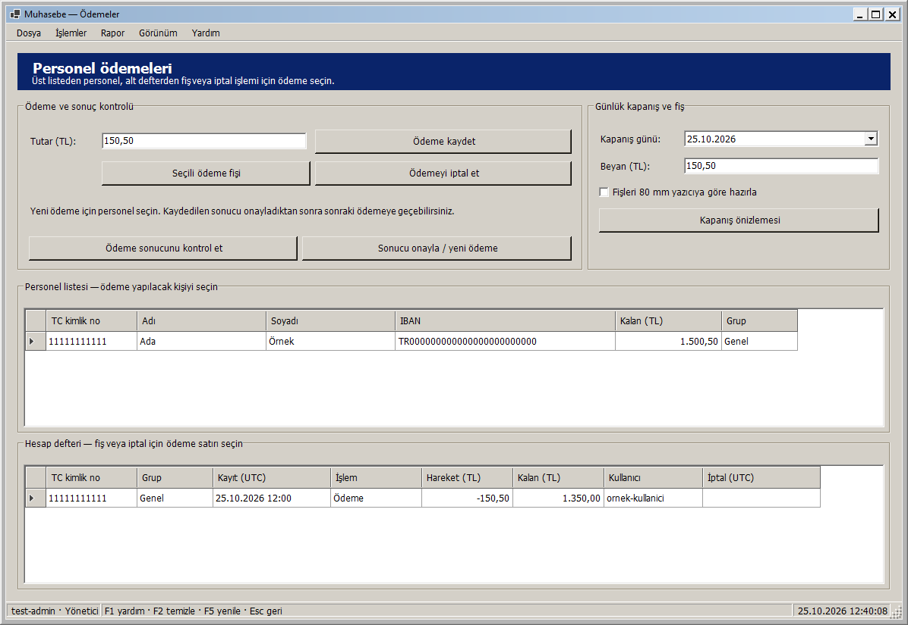

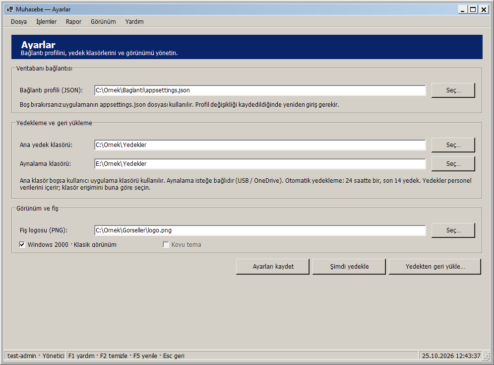

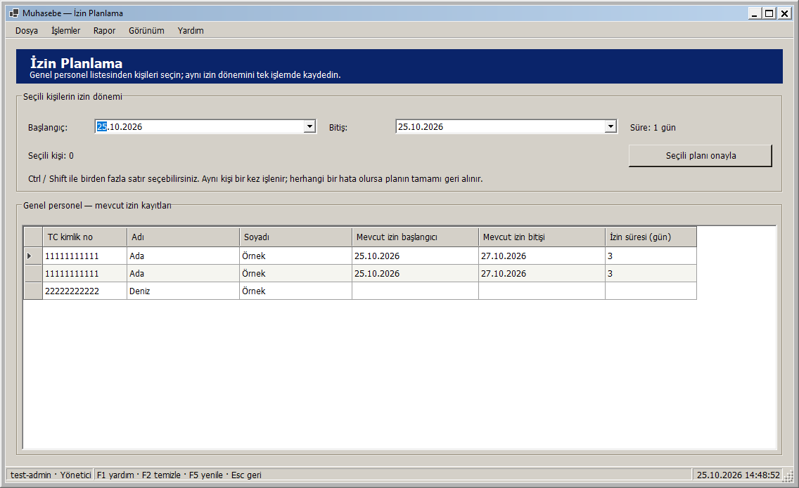

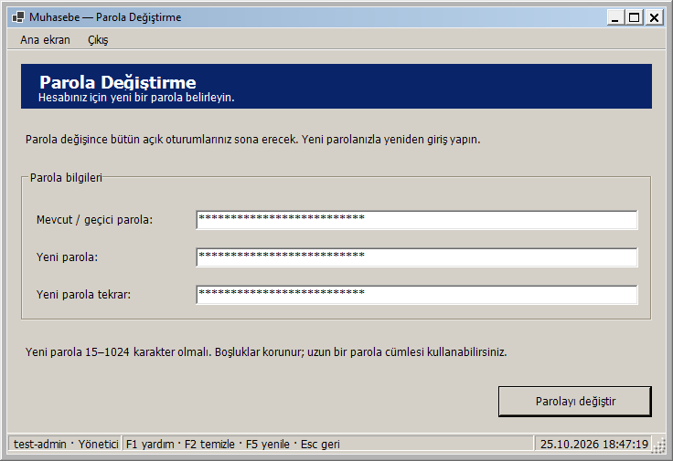

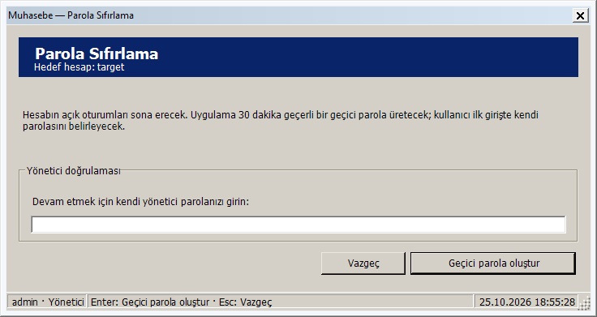

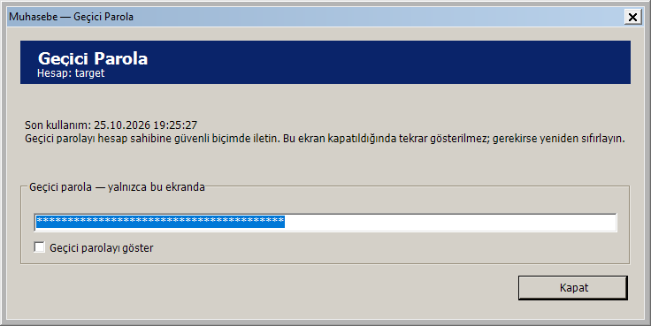

## Doğrulama

**26 Ekim 2026: 392 test başarılı, 0 başarısız, 0 atlanan.** Tam test takımı (yedekten geri yükleme dahil) ve uyarıları hata sayan Release derlemesi başarılı. Kanıt: `artifacts/analysis/master-20261026-025032-473/`. Ayrı LocalDB test motoru temizlendi; testlerde gerçek veritabanı kullanılmadı. Klasik ve açık/koyu ekran görüntüleri incelendi; role göre ağaç geçişi, klavye erişimi, maskeli parola alanları ve oturum uyarısı kontrol edildi.

Klasik kontrol çizimi yalnızca bu uygulamanın [Application.VisualStyleState](https://learn.microsoft.com/en-us/dotnet/api/system.windows.forms.application.visualstylestate) ayarıyla seçilir; Windows'un sistem teması değiştirilmez. Arayüz kaynakları ve örnek görseller GitHub kaynak güncellemesine dahildir. Mevcut v1.0.0 Release paketi bu değişiklikleri içermez; yeni bir Release yayımlanmadı. Güncel paket için başarılı GitHub Actions çalışmasının `AccountingApp-win-x64` çıktısı kullanılabilir.
