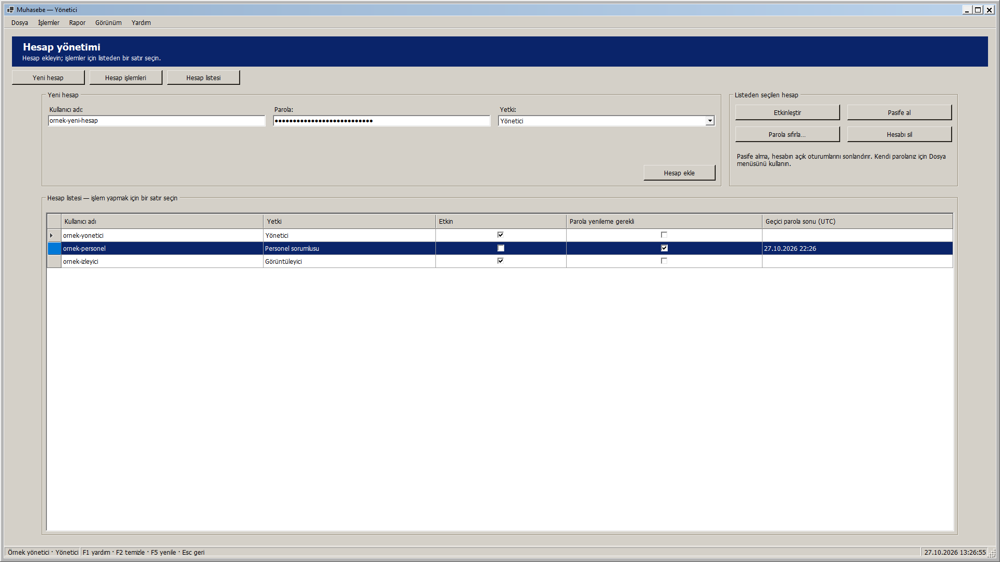
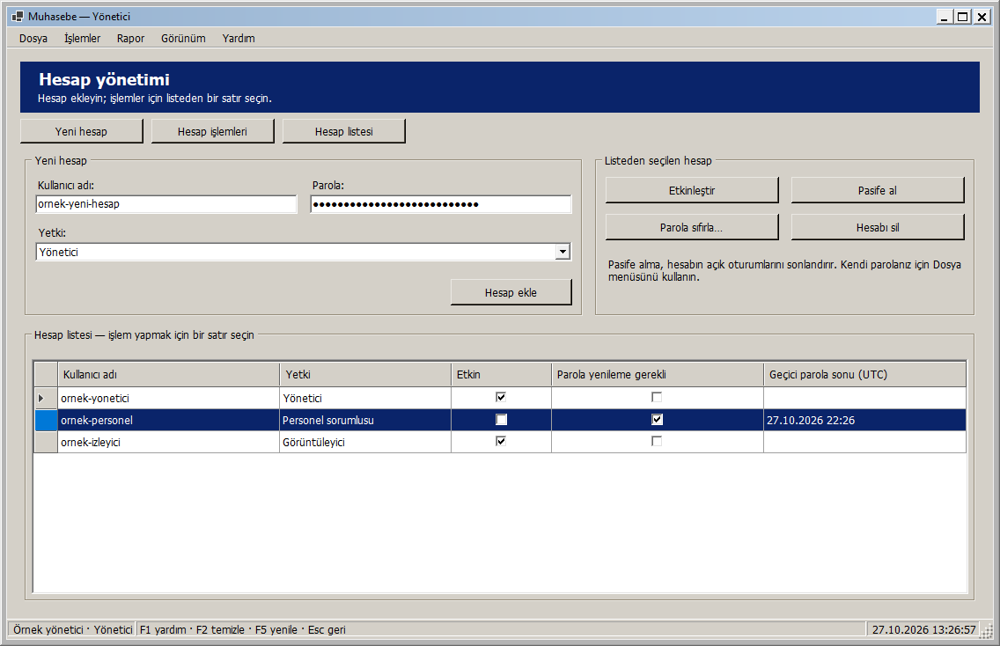
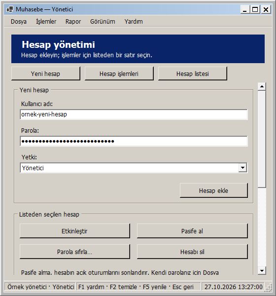
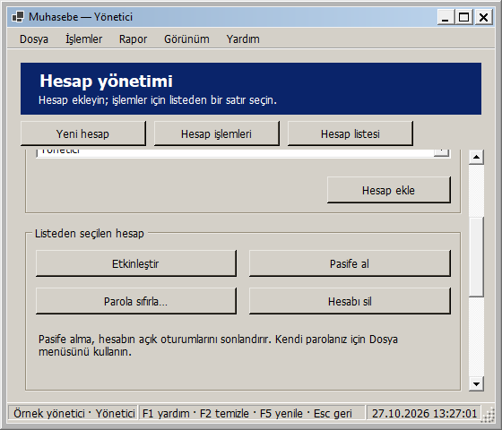
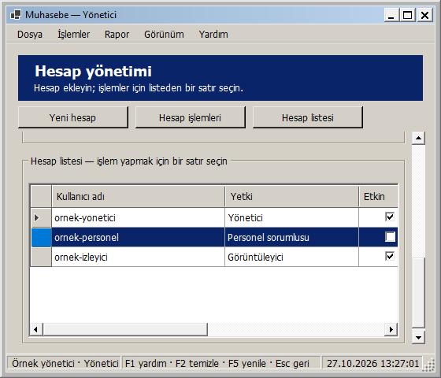

# Yönetici: pencere boyutuna uyarlanan yerleşim

27 Ekim 2026 — Windows 2000 görünümü korunarak Yönetici ekranı uyarlanabilir hale getirildi.

- Yeni hesap alanları kendi kullanılabilir genişliğine göre bir, iki veya üç sütuna geçer. Kullanıcı adı, maskeli parola, yetki seçimi ve Hesap ekle düğmesi aynı kontrollerdir; pencere boyutu değişiminde alanlar yeniden oluşturulmaz.
- Yeni hesap ve seçili hesap işlemleri geniş alanda yan yana, dar alanda alt alta yerleşir. Seçili hesap düğmeleri yeterli genişlikte dört, daha dar bölümde iki sütun olur; yükseklikleri sabittir.
- Hesap listesi kalan yüksekliği doldurur. Sütunlar geniş alana yayılır; dar pencerede minimum okunabilir genişliklerini korur ve tablonun kendi yatay kaydırması kullanılır. Sıra/görünürlük tercihleri korunur; dolgu modunda sütunlar alanı birlikte paylaşır.
- Kısa/dar pencerede içerik dikey kayar. Üstteki Yeni hesap, Hesap işlemleri ve Hesap listesi düğmeleri alanları/seçimi değiştirmeden ilgili bölüme geçer. Klavye odağı gizli kalan alan/düğmeye geçince içerik kaydırılır.
- En küçük pencere 560 × 480 mantıksal pikseldir; çok geniş ekranlarda içerik 1760 mantıksal piksel ile sınırlanır. Ölçüler DPI ile ölçeklenir.

Parola maskelemesi ve uzunluk sınırları, yetki açılır listesi, girilmiş fakat kaydedilmemiş bilgiler korunur. Yeniden boyutlandırmada sorgu veya hesap işlemi çalışmaz; bağlı liste, sıralanmış seçimin özgün kullanıcı adı/AccountVersion/AccountEpoch bilgileri korunur. Ekleme, silme, etkinleştirme/pasife alma ve parola sıfırlama işleyicileri değiştirilmedi. Mevcut yönetici yetkisi, eski seçim/sürüm korumaları, kendi hesap/son yönetici ve oturum güvenliği akışları sürer. Listedeki Türkçe yetki adları ve geçici parola bitişinin UTC gösterimi korunur.

## Gerçek uygulama önizlemeleri

Geniş pencere:

Normal pencere:

Dar pencerede yeni hesap:

Dar pencerede seçili hesap işlemleri:

Dar pencerede hesap listesi:

Görseller yayımlanan yerel DLL'den, yönetici rolündeki örnek oturumla gerçek WinForms çiziminden üretildi. Kullanıcı adları, hesap listesi ve maskeli parola örnek verilerdir; gerçek kullanıcı/parola kullanılmadı. Kayıt değiştiren veya parola sıfırlayan düğmeler çalıştırılmadı.

## Doğrulama

**311 veritabanısız test başarılı; 0 başarısız, 0 atlanan.** Release derlemesi 0 uyarı / 0 hata. Kanıt: `artifacts/analysis/master-20261027-132154-739/master.trx`.

Yeni üç yerleşim testi, yönetici oturumunda yeni hesabın üç yetki seçeneğiyle 26 genişliği iki yönde toplam **156 boyutlandırma durumu** ile denetler. Paneller/alanlar/düğmelerin sığması, sütun geçişleri, aynı veri kaynağı, korunmuş kullanıcı adı/parola/yetki ve özgün seçili hesap sürümü/epoch'u kontrol edilir. En küçük pencerede üç bölüme ve alan/düğmelere odakla erişim, büyütünce kaydırmanın kalkması ve açık/koyu temada parola maskesi/açıklama sığması da denetlenir. İki ayrı yetki testi, personel sorumlusu ve görüntüleyicinin Yönetici sayfasını açamadığını doğrular.

Yayımlanan DLL ile **yönetici oturumunda**, yeni hesap için üç yetki seçeneği ve yedi gerçek pencere boyutu (1920 × 1080, 1366 × 768, 1136 × 734, 1000 × 700, 800 × 600, 560 × 600, 560 × 480) olmak üzere **21 görsel yerleşim kontrolü** başarılı. Diğer roller için sayfa erişimi kapalı kalır. Boyutlar çerçeve dahil kaydedilir; panellerin çakışmaması, kontrollere/bölümlere erişim, parola maskesi ve seçim korunması doğrulanır. Kanıt: `artifacts/analysis/admin-adaptive/layout-checks.json` ve aynı klasördeki PNG'ler.

Önizlemeler yalnızca örnek tablolarla çalışır; gerçek hesap ekleme/silme, hesap durumunu değiştirme veya parola sıfırlama yapılmadı. Ortam 96 DPI'dır; farklı fiziksel DPI/monitör bu adımda ayrıca denenmedi. Yeni SQL betiği/şema yükseltmesi gerekmez. Bu ekranın yerel geliştirme adımında GitHub'a push veya Release yapılmadı; toplu kaynak gönderimi için [responsive arayüzler](RESPONSIVE_ARAYUZLER.md) belgesine bakın.

## Kendiniz deneyin

1. Muhasebe - Güncel kısayolundan yönetici olarak giriş yapıp Yönetici hesapları ekranını açın.
2. Yeni hesap alanlarına kaydetmeden örnek bilgiler girip pencereyi daraltın/genişletin; alan değerleri, parola maskesi ve yetki seçimi korunur.
3. Dar pencerede Yeni hesap, Hesap işlemleri ve Hesap listesi düğmelerini deneyin.
4. Listeden bir hesap seçip yeniden boyutlandırın; seçili satır korunur. Bu yerleşim denemesi için hesap işlem düğmelerine basmanız gerekmez.

Yerel paket: `artifacts/releases/admin-adaptive/`. Kabul edilen önceki uyarlanabilir ekranlar ve güvenlik/izin/ödeme/yedek düzeltmelerini de içerir.

Yerel dağıtım: Muhasebe - Güncel kısayolunun önceki bağlantısı yedeklendi ve hedef admin-adaptive paketine geçirildi. Mevcut appsettings.json birebir korundu. Computer Use ile yeni paket masaüstü oturumunda açıldı; startup ready kaydı ve açılan pencerenin yeni paket yolu doğrulandı. Uygulama açık bırakıldı. Kanıt: artifacts/analysis/admin-adaptive/deployment.json ve verification.json.
